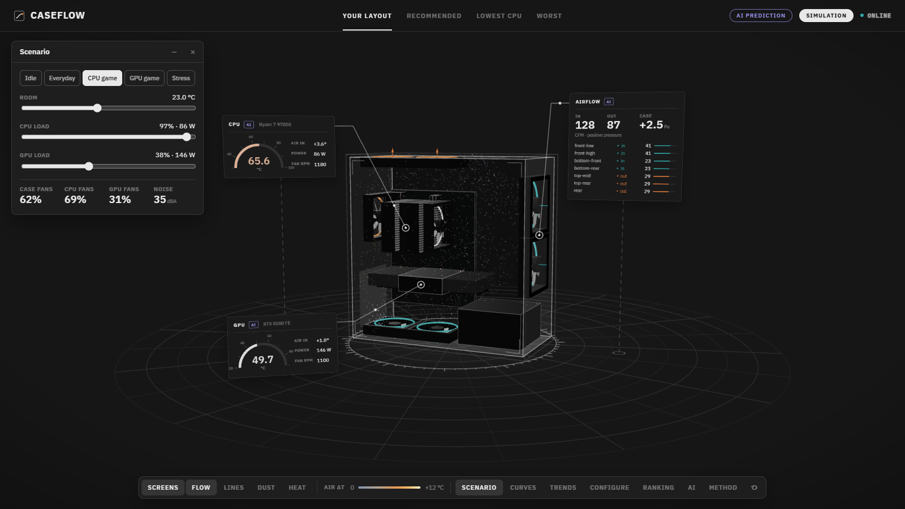
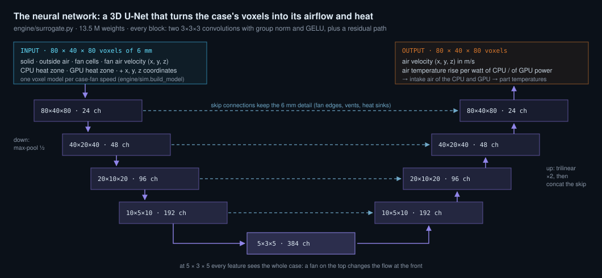
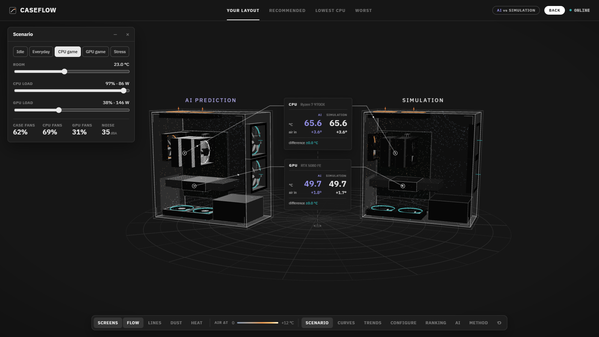
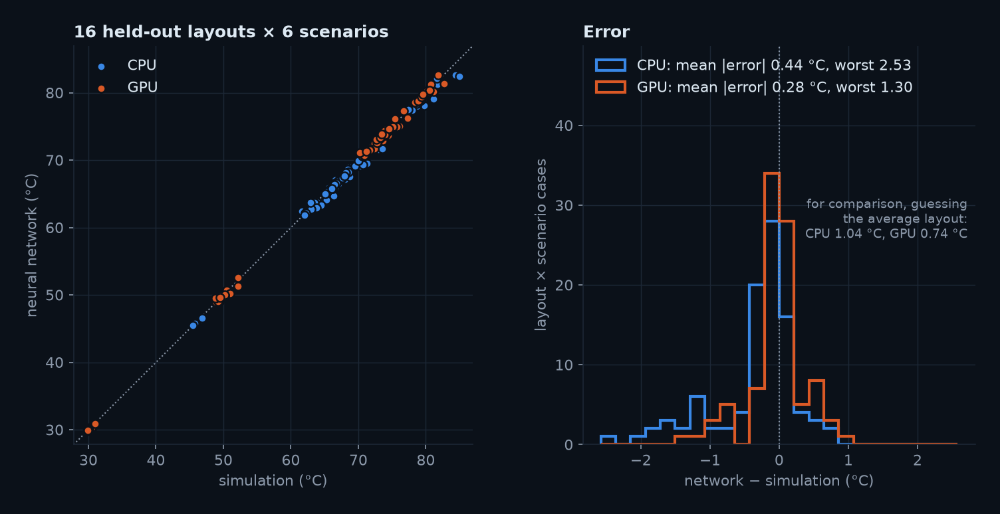
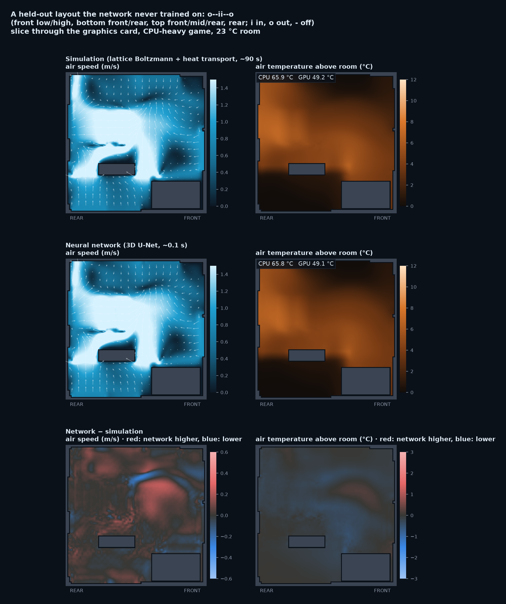
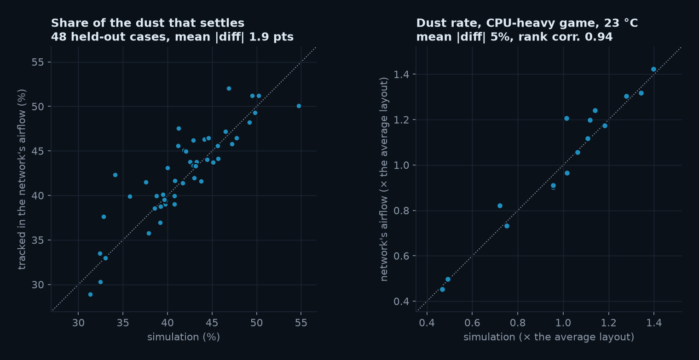
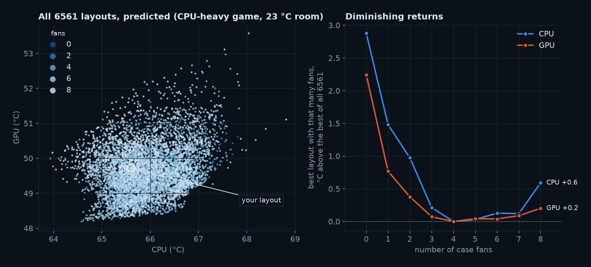
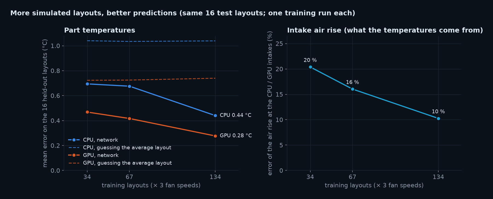

# CaseFlow

**Airflow, heat and dust inside your own PC case, for any room temperature, load and fan curve: simulated, ranked, and shown in 3D.**



**Walkthrough with figures, diagrams and a video (Chinese): [docs/GUIDE.md](docs/GUIDE.md)** · [demo video](docs/media/caseflow_tour.mp4)

You tell CaseFlow what is in your PC: case, graphics card, CPU and its cooler, and where the fans are and which way they blow. It builds the case on a 6 mm grid and then:

- solves the air flow with its own GPU lattice-Boltzmann solver, at three case-fan speeds at once;
- carries the CPU and GPU heat through that flow, as the temperature rise per watt;
- tracks dust particles from the openings to where they settle.

That is the build's **bank** (about 90 s on an RTX 5080, cached). From it, CaseFlow solves any **scenario** instantly, in the browser:

- **room temperature**, **CPU load** and **GPU load** (presets from idle to full stress, or sliders);
- **fan curves** like ASUS Fan Xpert: the case and CPU fans follow the CPU temperature, the GPU fans the GPU temperature and stop when it is cool. A hotter room or a heavier load spins them up, so temperatures rise by less than the room does; a part past its limit throttles.

It then tries **every** way to place your spare fans and ranks them for the scenario you set.

A **3D U-Net** trained on CaseFlow's own simulations predicts a layout's 3D airflow and heat in about **0.1 s** instead of 90 s. What the app shows is the network's prediction; **Simulation** in the header scans the simulated case in beside it and compares the two. The network also ranks all **6561** ways to fill the case's 8 fan mounts ([Neural surrogate](#neural-surrogate-ai)).

## Result for the reference build

The reference build is a Lian Li LANCOOL 207 with an RTX 5080 Founders Edition, a Thermalright Peerless Assassin 120 SE and a Ryzen 7 9700X:

- 4 stock fans: 2 × 140 mm front intake, 2 × 120 mm bottom intake.
- 3 extra 120 mm fans: top-mid, top-rear and rear, all exhaust.
- Every case fan follows the board's Fan Xpert curve.

The best of the 32 layouts and yours, in six scenarios. Temperatures are CPU / GPU °C; the gap is in score, CPU + GPU + 2 °C × dust settling (lower is better):

| Scenario | #1 | Yours | Gap | Worst (#32) |
|---|---|---|---|---|
| CPU-heavy game, 23 °C (default) | all three on top, out: 65.4 / 49.1 | #4: 65.6 / 49.7 | 0.9 | all seven fans in: 67.0 / 52.3 |
| Everyday use, 23 °C | top-front + top-mid in, top-rear out: 45.5 / 30.1 | #12: 45.7 / 30.2 | 0.6 | all seven in: 46.3 / 30.8 |
| GPU-heavy game, 23 °C | all three on top, out: 62.4 / 70.8 | #6: 63.0 / 71.6 | 1.4 | all seven in: 65.1 / 73.9 |
| Full stress, 23 °C | all three on top, out: 69.0 / 72.7 | #4: 69.3 / 73.1 | 0.8 | all seven in: 71.5 / 76.0 |
| GPU-heavy game, 30 °C | all three on top, out: 67.2 / 74.0 | #4: 67.5 / 74.5 | 0.9 | all seven in: 69.6 / 77.2 |
| Full stress, 35 °C (every fan at 100 %) | all three on top, out: 79.0 / 78.9 | #3, tied for #1: 79.0 / 79.0 | 0.3 | rear + top-rear in, top-front out: 82.6 / 81.8 |

- **Keep all three spare fans as exhaust.** Under load the four all-exhaust layouts are the top four in four of the five scenarios, and within the top six in the fifth.
- **Optional improvement:** move the rear fan to the empty top-front mount, still exhaust. "All three on top, out" is #1 in five of the six scenarios and #3 in the sixth. It gains 0.3–1.4 °C: most in the GPU-heavy game, while the fans still have headroom; nothing once they run flat out.
- **Never use the rear fan as an intake.** It blows into the CPU cooler's exhaust: the 12 layouts that do are the bottom 12 in every scenario.
- **At light load the layout hardly matters:** in everyday use all 32 are within 1.3 °C.
- **Dust barely depends on the layout** (×0.75–1.06 across all scenarios), because only the bottom has a filter. The optional front filter (LAN207-1X) cuts the unfiltered share of the intake from about 70 % to 17 %.

## Scenarios: what is set, and what changes

CaseFlow is a simulator: room, load, curves and parts are settings, nothing is read from the PC it runs on.

| Setting | Default | Notes |
|---|---|---|
| Room | 23 °C | The reference PC's room. |
| Load | CPU-heavy game: CPU 86 W, GPU 146 W | A preset; load runs from idle (0 %) to the power limit (100 %): 22–88 W for the 9700X, 15–360 W for the RTX 5080. *Everyday use* and *CPU-heavy game* reproduce the loads measured on the reference PC (42 / 14 W and 86 / 145 W). |
| Case-fan curve | 40 °C → 14 %, 60 °C → 40 %, 75 °C → 100 %, following the CPU | The reference PC's Fan Xpert smart mode. Editable; it can follow the GPU or the hotter of the two. Any fan can instead hold a fixed duty. |
| CPU-fan curve | 40 °C → 15 %, 60 °C → 50 %, 75 °C → 100 % | Fan Xpert. |
| GPU-fan curve | stopped below 40 °C, 30 % at 45 °C, 45 % at 70 °C, 100 % at 88 °C | Fitted to the 5080 FE: 31 % at 49 °C measured; zero-RPM at idle. |
| Fan speed | s_min + (1 − s_min) × duty | Most PWM fans keep turning at 0 % (s_min ≈ 0.2–0.26). |
| Coolers | G = 1 / (r_base + r_air × speed^−0.7) | Faster fans, better cooler. r_base is the chip's own path (die, solder, lid, paste). |

**How a warmer room now plays out** (your layout, CPU-heavy game): with fans that do not react, a room 5 °C warmer makes every part exactly 5 °C hotter: the air's temperature *rise* does not depend on the room. With the curves, the fans speed up and absorb part of it: from 23 to 28 °C the CPU warms 3.6 °C, not 5. In a cold room the reverse happens: the fans slow down. The **Trends** window plots both against the room temperature and the load.

**Against the reference PC** (room 23 °C, CPU-heavy game): the model gives CPU 65.6 °C and GPU 49.7 °C with the GPU fans at 31 %; the PC measured 65.3 °C and 49.3 °C at 31 %. In light use the model's CPU reads about 6 °C low (45.7 against 52 °C): a Ryzen's temperature at light load is set by short boost spikes, which a power-based model does not see.

**Is the instant solve right?** It makes two shortcuts: it interpolates between the three simulated case-fan speeds, and the cooler's and GPU's own fans stir the case air at one representative speed. `scripts/validate_bank.py` removes both: it re-simulates in full with every fan at exactly its solved speed and repeats until the speeds settle.

| Scenario | CPU: instant − full | GPU: instant − full |
|---|---|---|
| Everyday use, 23 °C | +0.19 °C | −0.21 °C |
| CPU-heavy game, 23 °C | +0.19 °C | −0.07 °C |
| GPU-heavy game, 23 °C | +0.18 °C | +0.02 °C |
| Full stress, 35 °C | +0.36 °C | −0.51 °C |

## Run

**Just look:** the web app runs without Python. Your layout's bank and the 32-layout summaries are precomputed, so every slider and curve works:

```bash
cd web && npm install && npm run dev        # http://localhost:5190
```

**Full setup** (other layouts in 3D, new layouts). You need Python 3.11+, Node 18+ (22.18+ for the test that runs the browser's solver), and an NVIDIA GPU for speed:

```bash
python -m venv .venv
.venv\Scripts\pip install torch --index-url https://download.pytorch.org/whl/cu124   # CUDA build of PyTorch
.venv\Scripts\pip install -r requirements.txt
cd web && npm install
```

Then on Windows double-click **`start.bat`**. It starts the engine on port 8600 and the web app on port 5190, then opens <http://localhost:5190>.

```bash
# engine (from this folder)
python -m uvicorn server.app:app --host 127.0.0.1 --port 8600     # or: bash scripts/serve.sh (auto-restart)

# web app
cd web && npm install && npm run dev                              # http://localhost:5190
```

With the engine running, every layout opens at once as the network's prediction; **Simulation** puts the simulation beside it (a few seconds when cached, as for the 32 searched layouts; about 90 s otherwise).

```bash
python engine/optimize.py          # a bank for all 32 layouts (~50 min on an RTX 5080, resumable)
python scripts/precompute.py       # the web app's offline data
python scripts/scenario_table.py   # every preset at several room temperatures, for your layout
python scripts/validate_bank.py    # instant solve against full simulations (~4 min)
python -m pytest tests             # fast checks (no GPU), incl. the browser solver against the Python one

# neural surrogate
python scripts/gen_surrogate_data.py --target 150   # training data: 150 layouts (~3 h, resumable)
python scripts/train_surrogate.py                   # train and score on the held-out layouts (~35 min)
python scripts/ai_space.py                          # predict all 6561 layouts for the web app (~7 min)
python scripts/ai_check.py                          # simulate the layouts the network picks
python scripts/ai_dust_check.py                     # dust in the network's airflow vs the simulation's (~2.5 min)
python scripts/train_surrogate.py --frac 0.5 --tag half   # learning curve: fewer training layouts, same test
```

## How it works

| Stage | Model |
|---|---|
| **Geometry** | Parts come from `data/parts/library.json`: dimensions, fan mounts, fan specs, cooling parameters and source links. They are placed in the case on a 6 mm grid. <br>Solid: walls, PSU, motherboard, GPU PCB and CPU fin towers (as heat zones). <br>Empty mesh mounts and the vented slot covers are open to the room. |
| **Air** | Our own D3Q19 lattice-Boltzmann solver (`engine/lbm.py`, PyTorch on the GPU) with BGK collision, Smagorinsky turbulence and bounce-back walls. <br>Fans are cells with a set air velocity. The layer of "room" cells around the case is an open boundary. <br>The three case-fan speeds run as one batch. |
| **Fans** | Each case fan runs at its **operating point**: Q = Q₀ (1 − Δp / p_max) against one case pressure p, balanced by the passive openings (Q = C_d A √(2\|p\| / ρ)), p by bisection. Without this, "all intake, no exhaust" ranked first. |
| **Heat** | CPU and GPU power enter the air in their fin stacks and are carried by the solved flow (conservative upwind fluxes; 99.9 % of the heat leaves through the openings). <br>The equation is linear in power, so the bank keeps the rise **per watt** of CPU and of GPU power: any load is P_cpu · k_cpu + P_gpu · k_gpu. |
| **Steady state** | Part temperature = room + intake air rise + P / G(fan speed). The case fans' duty comes from their curve at the source temperature, the coolers' from theirs, and the per-watt rise is interpolated between the three speeds in 1 / speed. Each temperature is found by bisection, alternating until both settle. A part past its limit (9700X 95 °C, 5080 88 °C) has its power cut until it sits at the limit. `engine/scenario.py`, ported line by line to `web/src/scenario.ts`. |
| **Dust** | 40 000 particles of 20 µm are released where air comes in, weighted by inflow; the bottom filter stops 85 %. They drift with the flow plus turbulent diffusion and settling, and stick where they touch. Faster case fans pull in more. |
| **Search** | Stock fans stay where they are. The spare fans go on every free mount, each blowing in or out (C(4,3) × 2³ = 32 layouts); each gets its bank. <br>Score = CPU + GPU °C + 2 °C × dust settling rate (current layout = 1), ranked for whatever scenario is set. Layouts within 0.5 °C of the top count as a tie. |

**Checks:**

| Check | Result |
|---|---|
| `validate_bank.py` | The instant solve against full simulations at the solved fan speeds: within 0.51 °C (table above). |
| `tests/test_scenario.py` | Fixed fans shift with the room exactly; curves absorb part of it; the solution is self-consistent; GPU fans stop at idle; throttling holds a part at its limit. The browser solver gives the same answers as the Python one to 1e-6. |
| `check_convergence.py` | Heat iterated to 80 000 steps and airflow to 16 000 steps: temperatures change by less than 0.1 °C. |
| `sanity_check.py` | Fans deliver about 95 % of their set flow. Heat carried out is 99.9 % of the input, and the exhaust air rise matches P / (ρ c_p Q). |
| `sensitivity.py` | Run on the fixed-speed model: diffusivity, fan derate, porosity, GPU slot height, front filter and a 4 mm grid change absolute temperatures by 2–3 °C but not the ranking, except among near-tied layouts. |

**Limits.**
- Mount positions, opening porosity and cooler parameters are estimates from specs and reviews (marked `est` in the library); the cooler parameters are fitted to one measured point.
- Fans are uniform jets without swirl; the cooler's and GPU's own fans stir the case air at one representative speed. All case fans on the curve share one curve.
- The grid uses a higher viscosity than real air, for stability. Buoyancy is not modelled, and the room outside stays at its set temperature, so hot exhaust is never drawn back in.
- Trust the differences between layouts more than the absolute temperatures.

## Neural surrogate (AI)

A simulation takes about 90 s. The 8 fan mounts, each off / in / out, give 3⁸ = **6561 layouts**, about a week of GPU time. So CaseFlow trains a **3D U-Net** on its own simulations to predict a layout's 3D fields in about **0.1 s**. The simulation stays the reference: the app shows the network's answer, and Simulation puts the simulated case beside it with the difference.



| | |
|---|---|
| **Data** | 150 layouts: the 32 of the search, the no-fan case and 117 random ones (fixed seed), each at 3 case-fan speeds: 400 training samples. Fan models per mount as on the reference PC. Every 7th random layout (16) is **held out** as a test. `scripts/gen_surrogate_data.py`, 4.1 h of GPU time, resumable. 34 of the random layouts (exhaust fans next to the small rear vent) blow up the LBM; they are rerun with a velocity limiter (4.5 m/s) and flagged. |
| **Network** | `engine/surrogate.py`. Input: 80 × 40 × 80 voxels × 8 channels (solid, outside air, fan cells, the fans' air velocity, CPU / GPU heat zones) + coordinates. 3D U-Net: residual 3×3×3 conv blocks with group norm and GELU, four halvings to 5 × 3 × 5 (the deepest features see the whole case) and back with skip connections; 13.5 M weights. Output: air velocity and the rise per watt of CPU and GPU power as log1p(k / 5 mK/W). The fans' operating points stay analytical. |
| **Training** | Squared error on the air in the case, plus the rises at the CPU and GPU intakes (they set the part temperatures). AdamW, one-cycle, bf16, 300 epochs, 35 min on an RTX 5080. `scripts/train_surrogate.py` |
| **Test** | 16 held-out layouts × 6 scenarios: mean error **CPU 0.44 °C, GPU 0.28 °C** (worst 2.5 / 1.3 °C, on layouts unlike most training layouts, e.g. no front fans). Guessing the training layouts' average gives 1.04 / 0.74 °C. Air speed RMSE 0.20 m/s; intake rise within 10 %. |
| **In the app** | Every layout appears as the AI's prediction (AI tags, a header chip). **Simulation** in the header slides the case left and scans the simulated case in on the right: a cached simulation in a few seconds, a new one following the run (~90 s). Cards between the two show both temperatures and the difference; a fan change ends the comparison while the simulation finishes in the background. The **AI** window compares the numbers and ranks all 6561 predicted layouts (`scripts/ai_space.py`, ~7 min) for the scenario on screen. Builds unlike the training data (other parts or fan models) get no prediction and show the simulation. |
| **Dust** | The network predicts no dust. With the Dust layer on, the simulation's own particle tracking (the same 40 000 particles and seed) runs in the network's airflow (`/api/ai/dust`, ~8 s on the GPU, cached). On the 16 held-out layouts × 3 fan speeds, the share of incoming dust that settles is within 1.9 points on average, the surface that gets the most matches in 47 of 48, and the dust rate in the CPU-heavy game is within 5 % (rank correlation 0.94). `scripts/ai_dust_check.py` |









**Search.** The network ranks all 6561 layouts in the browser in seconds; `scripts/ai_check.py` simulates what it picks. In the CPU-heavy game at 23 °C, its top layouts and its best layout for each fan count are within 0.5 °C of the simulation, including the ones it never trained on.

Its best of all 6561 runs CPU 64.6 / GPU 48.2 °C in the simulation, against 65.4 / 49.1 °C for the best of the 32-layout search and 65.6 / 49.7 °C for the reference layout:

- **The layout:** front fans out, top-front out, top-mid in.
- **Why it works:** cool air drops onto the CPU cooler's intake, and the GPU's exhaust leaves through the front.
- **The catch:** it means reversing the stock front fans for 1–1.5 °C, and the simulation has no buoyancy. The recommendation above stands.
- **Fan count:** four well-placed fans reach the best; more do not help.



**Learning curve.** Retrained on a quarter (34) and a half (67) of the training layouts, same 16 test layouts:

- CPU error: 0.69 → 0.68 → 0.44 °C.
- GPU error: 0.47 → 0.42 → 0.28 °C.
- Intake rise error: 20 % → 16 % → 10 %.

More simulated layouts are the direct way to a more accurate network, at about 2.5 h of GPU time per 100 layouts.



## Layout

```
engine/
  lbm.py          D3Q19 LBM solver (GPU, batched)
  sim.py          build → grid, fan operating point, airflow (single and batched), dust
  thermal.py      air temperature: one load, or the rise per watt for several airflows at once
  bank.py         a build at three case-fan speeds → bank (summary + 8-bit 3D fields), cached in data/banks
  scenario.py     fan curves, cooler conductance and the steady state of a bank in a scenario
  optimize.py     32-layout search: a bank each, ranked per scenario
  surrogate.py    neural surrogate: 3D U-Net, encoding, its design space (6561 layouts), bank prediction
server/app.py     FastAPI: /api/health, /library, /default_build, /bank, /job/{id}, /ai, /ai/info, /ai/dust
scripts/          precompute.py (offline data), scenario_table.py, validate_bank.py, serve.sh,
                  check_convergence.py, sanity_check.py, sensitivity.py (checks),
                  gen_surrogate_data.py, train_surrogate.py, ai_space.py, ai_check.py, ai_dust_check.py (neural surrogate)
data/             parts library, search result (optimize.json), validation.json; banks/ (cache, not in git);
                  surrogate/ (dataset, trained network, training history, test scores, AI and AI-dust checks)
web/              Vite + React + three.js app; src/scenario.ts is the browser's solver, src/AiWindow.tsx the AI window
tests/            engine, bank, scenario and surrogate checks
docs/             guide, figures, screenshots, video
```

## Interface

The 3D case sits among floating screens, each wired to its part by a thin leader line: CPU, GPU and Airflow by default, Dust with the Dust layer (off by default), Layout search and Verdict with Ranking in the dock. The look follows the [Data to Discovery](https://datavis.caltech.edu/projects) projects (ArtCenter / JPL / Caltech): neutral charcoal, flat panels and hairlines, colour only on the data - teal air in, copper air out, a heat ramp that brightens with temperature, violet for the AI. Drag a screen by its title to move it (the place is remembered); double-click the title to put it back, or ⟲ in the dock for all of them:

- **CPU** and **GPU**: temperature gauge, intake air rise, power (and throttling), fan rpm ("off" when the GPU fans idle).
- **Airflow**: in / out CFM, case pressure, and every fan's flow and speed.
- **Dust**: how fast outside dust settles, relative to your layout, and where it lands.
- **Layout search** and **Verdict**: the 32 layouts ranked for the current scenario, and your layout against the best.
- **AI Prediction / Simulation** (header): what you see is the network's prediction; Simulation shows the simulated case beside it, with cards comparing the two between them (Back or Esc returns).

Windows, from the dock at the bottom:

- **Scenario**: load presets, room / CPU-load / GPU-load sliders; the resulting fan duties and noise.
- **Fan curves**: drag the points of the case, CPU and GPU curves; a ring shows where each fan runs now.
- **Trends**: temperature against room temperature and against load, with the curves and with the fans held.
- **Configure**: parts, and every fan: direction, model, curve or fixed duty. **Method**: how it is computed.
- **AI**: the network against the simulation for the layout on screen (Compare in 3D opens the side-by-side view) and the model card; and all 6561 predicted layouts ranked for the scenario on screen.

**Click any case fan** in 3D to flip it or turn it off, or click an empty mount to add a fan (the case's stock fan for that mount). Any layout opens at once as the network's prediction (marked AI); **Simulation** in the header compares it with the simulation (about 90 s for a layout never simulated). The view is through the glass, front on the right, as the PC stands on a desk.
