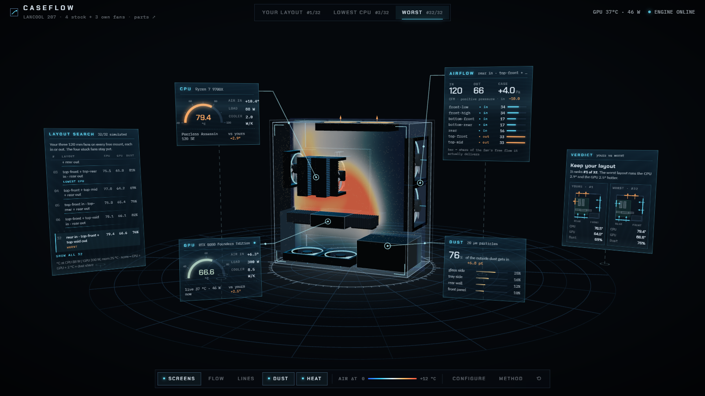

# CaseFlow 项目讲解

> 把你自己的电脑机箱放进一个虚拟风洞：看风怎么走、热量去哪、灰落在哪，再把你那 3 个风扇所有能装的方式都算一遍，告诉你现在这样装好不好。


▶ **[完整 30 秒演示视频（MP4，1440p）](media/caseflow_tour.mp4)**。上面的动图是前 13 秒：转视角 → 流线 → 温度切片 → 切到“最差布局”。

> 建议在 VS Code 里按 `Ctrl+Shift+V` 打开预览看这份文档，图和公式都能正常显示。

---

## 目录

0. [一分钟版本](#0-一分钟版本)
1. [怎么打开](#1-怎么打开)
2. [界面导览](#2-界面导览)
3. [整体架构](#3-整体架构)
4. [一次模拟是怎么算出来的](#4-一次模拟是怎么算出来的)
5. [32 种布局的搜索](#5-32-种布局的搜索)
6. [结论：你的电脑该怎么装](#6-结论你的电脑该怎么装)
7. [可信度：哪些是算的，哪些是估的](#7-可信度哪些是算的哪些是估的)
8. [代码地图](#8-代码地图)
9. [常用操作](#9-常用操作)

---

## 0. 一分钟版本

| | |
|---|---|
| **输入** | 你的配件：联力 LANCOOL 207 机箱、RTX 5080 公版显卡、利民 PA120 SE 双塔散热器；4 个原装风扇 + 你自己的 3 个 120 mm 风扇，以及每个风扇装在哪、往哪吹。 |
| **计算** | 1. 把机箱切成 6 mm 的小格子。<br>2. 用自己写的 GPU 流体求解器（格子玻尔兹曼方法）算出机箱里的风。<br>3. 让 CPU 和显卡的热量跟着风走，得到它们吸进去的空气有多热。<br>4. 放 4 万颗灰尘颗粒，看它们落在哪。 |
| **搜索** | 你那 3 个风扇放到 4 个空位里的任意 3 个，每个可以进风或出风，一共 **32 种**，每一种都完整算一遍（约 35 秒一种，19 分钟全部算完）。 |
| **结论** | **你现在的装法（顶中 + 顶后 + 后部，全部出风）是 32 种里的第 1 名，不用改。** 最差的是把后部风扇改成进风：CPU 热 2.9 °C，显卡热 2.5 °C。 |
| **界面** | 3D 机箱放在中间，周围浮着六块全息屏，每块用发光引线连到对应的部件上。 |

---

## 1. 怎么打开

| 方式 | 做法 |
|---|---|
| 一键启动 | 双击 `caseflow/start.bat`。它会开两个服务，然后自动打开浏览器。 |
| 网页 | <http://localhost:5190>（Vite + React + three.js） |
| 计算引擎 | <http://127.0.0.1:8600>（FastAPI + PyTorch，用显卡算） |

**引擎没开也能看**：你的布局、CPU 最低、最差这三个视图，以及 32 种布局的排名，都预先算好放在 `web/public/data/` 里了。

**引擎开着的时候多出来的功能**：
- 读实时的显卡温度和功率（`nvidia-smi`）；
- 识别 CPU、主板、内存；
- 在 Configure 窗口里改配置，跑新的模拟（约 40 秒）；
- 用实测的显卡温度校准散热器。

---

## 2. 界面导览


机箱周围浮着六块**全息屏**，每块用一根发光引线连到它描述的那个部件上。屏幕会跟着你的视角转，所以从哪个角度看都正对着你；引线和部件上的锚点固定在机箱里。

| # | 屏幕 / 位置 | 内容 |
|---|---|---|
| ① | **LAYOUT SEARCH**（左侧斜屏） | 32 种布局的排名：CPU / 显卡温度、进灰比例。<br>默认显示前 6 名和几个有标记的（YOURS、LOWEST CPU、WORST），点 *Show all 32* 看全部，列表会自动滚到当前选中的那一行。<br>点任意一行就切到那种布局；预先没算的布局，引擎开着时会现场算。 |
| ② | **CPU**（引线 → CPU 散热器） | 半圆仪表显示 CPU 温度，旁边是吸入空气的温升、功耗、散热器导热能力。 |
| ③ | **GPU**（引线 → 显卡） | 同上。引擎开着时，底部显示显卡的实时温度和功率。 |
| ④ | **AIRFLOW**（引线 → 前面板进风扇） | 总进风 / 出风量（CFM）、机箱内压力。<br>下面逐个列出风扇：方向、实际风量，以及一根条表示它在工作点上发挥了自由风量的多少。 |
| ⑤ | **DUST**（引线 → 玻璃侧板前下角） | 外面的灰有多少进了机箱，以及灰落在哪些面上。 |
| ⑥ | **VERDICT**（右侧斜屏） | 一句话结论，加上你的布局和对照布局的侧视示意图（隔着玻璃看：后部在左、前面在右，青色箭头进风、琥珀色箭头出风）。点示意图可以切换视图。 |
| ⑦ | **视图切换** | Your layout #1/32 · Lowest CPU #3/32 · Worst #32/32 |
| ⑧ | **底部 dock** | 图层开关：全息屏 Screens、气流粒子 Flow、流线 Lines、积灰 Dust、温度切片 Heat。中间是温度色标。右边是 Configure（改配置、跑模拟）、Method（模型说明）和 ⟲（视角和窗口复位）。 |
| ⑨ | **引线和锚点** | 部件上的锚点会脉动，引线上有光点从部件流向屏幕。 |
| ⑩ | **点风扇** | 点任意一个机箱风扇，弹出菜单，可以**翻转方向**或**关闭**；点空着的风扇位可以**加一个风扇**（进或出）。<br>改完后：如果新布局在 32 种里且已存好视图，直接切过去；否则引擎开着就重新模拟（约 40 秒），结果出现在 CUSTOM 视图；引擎没开时，如果新布局在 32 种里，会显示它的温度和进灰。 |

**怎么看 3D 场景**：
- **操作**：鼠标左键拖动旋转，滚轮缩放，右键平移。
- **视角**：默认从玻璃侧板偏前面板的角度看，前面板在右边，和你桌上的电脑一样。
- **风扇**：灯圈青色 = 进风，琥珀色 = 出风；扇叶转速按风扇的转速百分比。
- **气流粒子**：沿着算出来的风走，颜色表示那里的空气比室温高多少（蓝 → 青 → 白 → 琥珀 → 红，0 到 +12 °C）。
- **积灰点**：土黄色的点，表示灰最后停下来的位置。
- **温度切片**：从显卡中间切一刀。越热的地方越不透明，看起来像热浪。
- **差值**：看别的布局时，屏幕上会显示和你的布局的差值。青色 = 更好，琥珀色 = 更差。

| 最差布局 + 温度切片 | 点风扇弹出的菜单 |
|---|---|
|  |  |

**试一个例子**：点底部靠后（左下）那个原装进风扇 → *Flip → blow out*，重新模拟后：CPU 75.0 °C（−1.5），显卡 64.5 °C（+0.5），进灰 80%（+11 个百分点）。
- 按总分它其实比你现在的布局略好（CPU + 显卡 + 2 × 进灰：141.1 对 141.9），因为 CPU 凉得多。
- 代价是灰多 11 个百分点。
- 还有一点模型没算到：它假设机箱外的空气永远是 25 °C，而真实桌面上往下排的热风可能被前面板吸回去。
- 这个布局不在 32 种搜索里，因为搜索时原装风扇是固定的。

---

## 3. 整体架构


- **网页**只负责显示。它拿到的是速度场和温度场（float16，base64 编码），流线和粒子的轨迹在浏览器里用 RK2 积分现场算出来。
- **服务**把每次模拟当成一个后台任务：网页提交后拿到一个任务 id，再轮询进度。显卡一次只跑一个模拟（加了锁）。
- **引擎**和网页之间只通过 JSON 交流。所以整个文件夹可以单独拿走，不依赖 Spatial Lab 的任何代码。

---

## 4. 一次模拟是怎么算出来的


### 4.1 把机箱变成格子（第 1–2 步）

**配件库** `data/parts/library.json` 里每个配件都记了：
- 尺寸、风扇位坐标、风扇参数（额定风量 CFM、静压 mmH₂O、最高转速）；
- 来源链接；
- 估计出来的值会标上 `est`。

`build_model()` 把这些放进一个 **80 × 40 × 80** 的格子里（每格 6 mm，最外两层是“房间”和“机箱壁”），每个格子标成一种类型：


| 类型 | 怎么处理 |
|---|---|
| 实体 | 机箱壁、电源、主板、显卡的 PCB。风碰到会反弹（halfway bounce-back）。 |
| 机箱风扇 | 强制风速的格子，方向朝里（进风）或朝外（出风）。风速由 [4.3 节](#43-风扇工作点第-3-步) 的工作点决定。 |
| 散热器 / 显卡风扇 | 同样是强制风速。CPU 双塔的两个风扇从前往后吹；公版显卡的两个风扇从下往上吹（双通道穿透式散热）。 |
| 发热区 | CPU 的两个鳍片塔、显卡两端的鳍片。热量在这里放进空气。 |
| 通到房间 | 空着的网孔风扇位、PCIe 挡板的通风孔。空气可以自由进出。 |
| 房间 | 最外一圈格子，一直保持静止的室温空气。 |

### 4.2 气流：格子玻尔兹曼方法（第 4 步）

不直接解 Navier–Stokes 方程，而是用**格子玻尔兹曼方法（LBM）**。每个格子里存 19 个“粒子分布”$f_i$，表示朝 19 个方向走的空气有多少：


每一步做两件事：

1. **碰撞**：每个格子里的分布向局部平衡态靠拢。用的是 BGK 碰撞，加 Smagorinsky 湍流模型来稳定小尺度的涡。

$$
f_i^{*}(\mathbf x,t)=f_i-\frac{1}{\tau}\left(f_i-f_i^{\text{eq}}\right),\qquad
f_i^{\text{eq}}=w_i\,\rho\left(1+3\,\mathbf c_i\!\cdot\!\mathbf u+\tfrac92(\mathbf c_i\!\cdot\!\mathbf u)^2-\tfrac32 u^2\right)
$$

2. **迁移**：每个分布沿着自己的方向走一格，$f_i(\mathbf x+\mathbf c_i,t+1)=f_i^{*}(\mathbf x,t)$。

密度和速度直接从分布里加出来：$\rho=\sum_i f_i$，$\rho\mathbf u=\sum_i f_i\mathbf c_i$。

**为什么用 LBM**：每个格子只和邻居打交道，几十万个格子可以在显卡上同时算，PyTorch 一行张量操作就能做完一整步。

**具体设置**：
- 跑 8000 步（相当于真实时间约 1.6 秒，空气大约在机箱里走三到四遍）；
- 取后 4000 步的**时间平均**作为结果；
- 检查过：再加到 16000 步，你的布局和最差布局的温度变化不到 0.1 °C；全进风这种低风量布局约 0.4 °C（`scripts/check_convergence.py`）；
- 力和场在相邻两步上成对采样，避免周期为 2 的数值振荡被采样“折叠”成偏差。这是在风洞项目里发现并修好的。

### 4.3 风扇工作点（第 3 步）

这一步是模型里最有意思的部分，也是在一次“结果不对劲”之后加的。

- **以前**：每个风扇按固定风量算（额定风量 × 转速 × 0.6）。
- **出问题**：用这个模型跑 32 种布局时，“顶部 3 个全进风、一个出风扇都没有”排到了第一。这不合理：7 个风扇一起往里吹，机箱里的气压会升高，风扇会被顶住，实际风量会大幅下降。
- **现在**：把整个机箱当成一个腔体，所有机箱风扇面对**同一个机箱压力 $p$**。

| | 公式 | 说明 |
|---|---|---|
| 风扇曲线 | $Q = Q_0\left(1-\dfrac{\Delta p}{p_{\max}}\right)$ | $Q_0$ 是额定风量，$p_{\max}$ 是厂家标的静压。转速变化时按风扇定律缩放：$Q\propto n$，$p\propto n^2$。 |
| 风扇两边的压差 | 进风扇 $\Delta p=+p$<br>出风扇 $\Delta p=-p$ | 机箱是正压时，出风扇反而被推了一把，流量最多到 1.25 倍。 |
| 被动开口 | $Q = C_d\,A_\text{eff}\sqrt{2\lvert p\rvert/\rho}$ | 按孔板算，$C_d=0.6$。 |
| 质量守恒 | $\sum Q_\text{进}-\sum Q_\text{出}-Q_\text{开口}=0$ | 左边随 $p$ 单调下降，用二分法就能找到唯一解。 |


两条线的交点就是工作点：
- **左图（你的布局）**：机箱比房间高 +1.8 Pa，进风 130 CFM。
- **右图（全进风）**：压力憋到 +7.8 Pa，总进风只剩 75 CFM，底部两个风扇只剩自由风量的 18%。

加了这一步之后，“顶部 3 个全进风”从第 1 名掉到了第 14 名；后来温度改成迭代到收敛（见 4.4），又掉到第 17 名。这也说明了为什么模型里要有物理约束：只看“风扇越多越好”会得出错误结论。

### 4.4 温度（第 5 步）

在 LBM 算出的平均风场上，解一个稳态的**对流–扩散方程**（迎风格式，一直迭代到收敛）：
- 每个发热区每格放进 $P/N$ 的热量；
- 墙不导热；
- 房间格子保持室温。

这样得到机箱里每个格子比室温高多少，取 CPU 和显卡**进风口**处的平均值，算零件温度：

$$
T_\text{零件}=T_\text{室温}+\Delta T_\text{进风}+\frac{P}{G}
$$

$G$ 是散热器的导热能力（W/K）。默认值：双塔 2.0，公版穿透式 8.5。也可以在 Configure 窗口里填一个**实测温度**来反推：$G=P/(T_\text{实测}-T_\text{室温}-\Delta T_\text{进风})$。


**怎么读这张图**（左边是风速和风向箭头，右边是空气温度）：
- **公版显卡**的热风从卡中间往上冲，正好吹向 CPU 散热器的进风面。所以 CPU 吸进去的空气比室温高 +7.5 °C，这是 CPU 温度的主要来源。
- **底部两个原装风扇**把冷空气直接送到显卡下面，所以显卡吸入的空气只高 +3.7 °C。
- **最差布局（下排）**后部风扇改成往里吹，正对着 CPU 散热器的出风口。散热器吹出的热风被顶回来，在机箱上半部打转，CPU 吸入的空气升到 +10.4 °C。

> **一个被问出来的 bug（温度没算收敛）**
>
> 你问：“全部往里吹，温度怎么还比最差的低？” 查下来，原来温度是固定迭代 5000 次（约 1 秒真实时间），还没收敛，热量没积累够。风量越小，空气在机箱里停留越久，低估得越多：全进风只有 75 CFM，空气要停留约 1.3 秒。
>
> | 布局 | 5000 次（原来） | 收敛后 |
> |---|---|---|
> | 你的布局 | 75.6 / 63.4 °C | 76.5 / 64.0 °C |
> | 全进风（7 个都往里） | 75.8 / 65.5 °C | 78.0 / 67.6 °C |
> | 最差（后部进风） | 77.2 / 64.9 °C | 79.4 / 66.6 °C |
>
> 现在的做法：每 2500 次检查一次进风口温度，变化小于 0.005 °C 才停（一般 1.5–4 万次），32 种全部重算。你的布局还是第 1；全进风从第 25 名掉到第 31 名，只比最差的好一点。

### 4.5 灰尘（第 6 步）

**怎么放灰**：4 万颗 20 µm 的颗粒，从空气**进来**的地方放进去，按各处进风量分配：
- 底部有防尘网，挡住 85%；
- 前面和顶部的网孔不挡灰。

**每一步颗粒怎么动**：
- 跟着平均风走；
- 加上湍流造成的随机扩散（2×10⁻³ m²/s）；
- 加上重力沉降（斯托克斯速度）；
- 碰到表面就粘住。


- **最多的是玻璃侧板和背板**，因为机箱窄，颗粒很容易横着飘到两侧。
- **最差布局的后壁积灰明显多**（9% → 12%）：后部风扇往里吹，直接把外面的灰打在后壁和 I/O 附近。
- **两种布局进灰比例不同**：你的布局 69%，最差布局 76%。“进灰比例”是外面的灰有多少进了机箱；你的布局里，所有进风都来自前面（无网）和底部（有网），所以是 69%。

### 4.6 打分（第 7 步）

$$
\text{score}=T_\text{CPU}+T_\text{GPU}+2\,^{\circ}\mathrm{C}\times(\text{进灰比例})
$$

分数越低越好。权重是人为定的：外面的灰多进来 100%，相当于温度高 2 °C。所以温度差不多的时候，灰少的布局排在前面。

---

## 5. 32 种布局的搜索

**怎么搜**：
- 原装 4 个风扇（前 2 × 140 进风、底 2 × 120 进风）保持原样；
- 你的 3 个 120 mm 风扇放到 4 个空位（顶前 / 顶中 / 顶后 / 后部）里的任意 3 个，每个可以进或出：$\binom43\times2^3=32$ 种；
- 每种都完整跑第 3–7 步，**不是人工挑候选，而是穷举**；
- 每算完一种就存一次，中途断了可以接着算（`engine/optimize.py`）。


点越亮，表示你的 3 个风扇里往里吹的越少。图里能看出三个规律：

| 规律 | 证据 |
|---|---|
| **全部出风最好** | 最亮的 4 个点（0 个进风）都在最下面，显卡温度最低（64.0–64.2 °C）。第 1、2 名都是这一类，只差 0.4 °C，区别只是顶部用哪两个孔。 |
| **每多一个进风，显卡就更热** | 显卡温度：0 个进风 64.0–64.2 °C，1 个 65.4–66.6 °C，2 个 65.8–66.9 °C，3 个 66.8–67.6 °C。顶部往里吹会“压住”显卡往上排的热风。 |
| **后部进风最差** | 最后 8 名（第 25–32 名）全都带“后部进风”。只有后部一个进风的那 3 种，CPU 78.9–79.4 °C。 |
| **全进风很差** | 7 个风扇全往里吹（第 31 名）：总风量只剩 75 CFM，显卡 67.6 °C，是 32 种里最热的，进灰 88%。 |

**CPU 最低的那种**（顶前 + 顶后进风、后部出风，75.1 °C）：冷风从顶上直接落到 CPU 散热器上，所以 CPU 凉了 1.4 °C。但显卡 +1.8 °C、进灰 +12 个百分点，总分排第 3。

---

## 6. 结论：你的电脑该怎么装

> **不用改。** 你现在的装法：前面 2 进、底部 2 进，顶中、顶后、后部 3 个出风。它在 32 种里排第 1，CPU 76.5 °C、显卡 64.0 °C、进灰 69%（CPU 88 W、显卡 300 W、室温 25 °C）。

如果以后要动风扇：
- **顶部用哪两个孔无所谓**，方向才重要：保持往外吹。
- **别把顶部的风扇改成进风**：显卡会更热，灰也更多（顶部没有防尘网）。
- **千万别把后部风扇改成进风**：它会把 CPU 散热器吹出来的热风顶回去。
- **想少进灰**：主要靠底部有防尘网的进风。前面的网孔不挡灰，可以考虑在前面加一层防尘网。

---

## 7. 可信度：哪些是算的，哪些是估的

| 类别 | 内容 |
|---|---|
| **来自规格或实测** | 机箱尺寸和最大显卡长度、风扇额定风量和静压、显卡长度和功耗、散热器高度（官方规格页，链接在配件库里）；你的 CPU、内存、显卡（`hardware.py` 现场读出）。 |
| **估计值**（配件库里标了 `est`） | 风扇位的具体坐标（按评测图片估的）、PCIe 挡板通风面积、开孔率（0.6 / 0.4）、防尘网效率（85%）、散热器导热能力 $G$、风扇装机后的折减（0.6）。 |
| **模型简化** | 6 mm 的格子；为了数值稳定，求解器的黏度比真实空气大，能抓住大尺度的风道，抓不住很小的涡。风扇是均匀的出风面，没有旋转气流。CPU 功耗 88 W、显卡 300 W 是固定的游戏负载。 |
| **做过的检查** | ① LBM 求解器在风洞项目里验证过：球体阻力和经验公式对比、质量守恒、阻塞比；② `tests/test_engine.py` 检查风扇曲线的边界、工作点的质量守恒、全进风会被顶住、搜索空间正好 32 种且只有一种是你的；③ 收敛检查（`scripts/check_convergence.py`）：温度迭代到 8 万次、气流算到 1.6 万步，确认现在的设置已经收敛。之前固定 5000 次的温度没收敛，低风量布局被低估了 2–3 °C，已修正并全部重算（见 4.4）。 |

所以：**布局之间的比较是可信的**，因为所有布局用的是同一套假设。绝对温度可能差几度，用 Configure 里的“GPU measured → use live”在玩游戏时校准一次会更准。

---

## 8. 代码地图

```
caseflow/
├─ start.bat                一键启动（引擎 :8600 + 网页 :5190）
├─ engine/
│  ├─ lbm.py                D3Q19 LBM 求解器（PyTorch，显卡）
│  ├─ sim.py                build_model() 建格子 · operating_point() 风扇工作点 ·
│  │                        simulate_build() 跑气流 + 温度 + 积灰 · package() 打包给网页
│  ├─ thermal.py            solve_temperature() 对流–扩散 · calibrate_g() 校准
│  ├─ optimize.py           32 种布局穷举（可续跑）
│  └─ hardware.py           CPU / 主板 / 内存（Windows CIM），显卡传感器（nvidia-smi）
├─ server/app.py            FastAPI：/api/health /hardware /library /default_build /simulate /job/{id}
├─ scripts/precompute.py    把搜索结果打包成网页视图 → web/public/data/
├─ data/                    parts/library.json 配件库 · optimize.json 搜索结果
├─ tests/test_engine.py     不用显卡的快速检查
├─ web/src/
│  ├─ App.tsx               顶栏、六块全息屏的内容和位置、Configure / Method 窗口、dock
│  ├─ Holo.tsx              全息屏：外框、温度仪表、气流 / 积灰 / 结论 / 排名面板
│  ├─ HudWindow.tsx         可拖动、折叠的玻璃窗口（Configure、Method）
│  ├─ Scene.tsx             three.js 场景：线框机箱、部件、风扇、粒子、温度切片、积灰；
│  │                        CSS3D 全息屏层、引线、锚点、投影光柱
│  ├─ Schematic.tsx         隔着玻璃看的侧视示意图
│  ├─ streamlines.ts        速度场插值 + RK2 流线
│  └─ palette.ts / styles.css   颜色和样式
└─ docs/
   ├─ GUIDE.md              就是这份
   ├─ make_figures.py       重新生成 media/ 里的图
   ├─ make_video.py         把录屏帧编码成 MP4 / GIF
   └─ media/ · screens/     图、视频、截图
```

---

## 9. 常用操作

```bash
cd caseflow

# 重新跑 32 种布局（约 19 分钟，断了可以接着跑）
python engine/optimize.py
python scripts/precompute.py          # 生成网页用的视图

# 测试
python -m pytest tests

# 重新生成文档里的图 / 视频（网页要开着）
python docs/make_figures.py
node web/scripts/tour.mjs <临时目录>  &&  python docs/make_video.py <临时目录>
```

**加一个新配件**（比如换了散热器）：在 `data/parts/library.json` 里照着已有的条目加一项（尺寸、风扇、来源链接），然后在网页 Configure 窗口里选它，点 *Run simulation*。也可以直接告诉 Claude Code 型号，让它上网查规格后加进去。

**校准**：
1. 打开引擎，玩一会儿游戏让显卡满载；
2. 在 Configure 里点 GPU measured 旁边的 *use live*；
3. 点 *Run simulation*。

结果会用实测温度反推散热器的导热能力 $G$，之后的温度就是按你这台机器校准过的。
