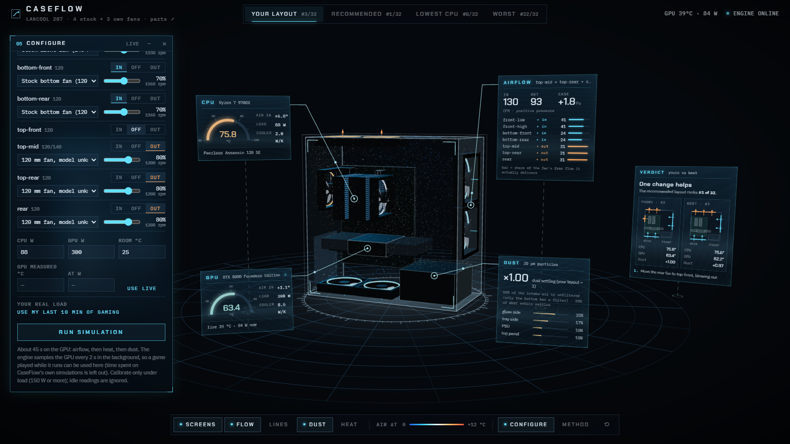

# CaseFlow 项目讲解

> 把你自己的电脑机箱放进一个虚拟风洞：看风怎么走、热量去哪、灰落在哪，再把你那 3 个风扇所有能装的方式都算一遍，告诉你现在这样装好不好。


▶ **[完整 30 秒演示视频（MP4，1440p）](media/caseflow_tour.mp4)**。上面的动图是前 13 秒：转视角 → 流线 → 温度切片 → 切到“最差布局”。

> 建议在 VS Code 里按 `Ctrl+Shift+V` 打开预览看这份文档，图和公式都能正常显示。

---

## 目录

0. [一分钟版本](#0-一分钟版本)
1. [怎么打开](#1-怎么打开)
2. [界面导览](#2-界面导览)
3. [整体架构](#3-整体架构)
4. [一次模拟是怎么算出来的](#4-一次模拟是怎么算出来的)
5. [32 种布局的搜索](#5-32-种布局的搜索)
6. [结论：你的电脑该怎么装](#6-结论你的电脑该怎么装)
7. [输入从哪来：转速、功率、使用率](#7-输入从哪来转速功率使用率)
8. [可信度：哪些是算的，哪些是估的](#8-可信度哪些是算的哪些是估的)
9. [代码地图](#9-代码地图)
10. [常用操作](#10-常用操作)

---

## 0. 一分钟版本

| | |
|---|---|
| **输入** | 你的配件：联力 LANCOOL 207 机箱、RTX 5080 公版显卡、利民 PA120 SE 双塔散热器；4 个原装风扇 + 你自己的 3 个 120 mm 风扇，以及每个风扇装在哪、往哪吹。<br>**风扇转速和功率是设定值，不是从电脑里读的**：原装风扇 70%、你的 80%；CPU 88 W、显卡 300 W；室温 25 °C。使用率不参与计算。见[第 7 节](#7-输入从哪来转速功率使用率)。 |
| **计算** | 1. 把机箱切成 6 mm 的小格子。<br>2. 用自己写的 GPU 流体求解器（格子玻尔兹曼方法）算出机箱里的风。<br>3. 让 CPU 和显卡的热量跟着风走，得到它们吸进去的空气有多热。<br>4. 放 4 万颗灰尘颗粒，看它们落在哪。 |
| **搜索** | 你那 3 个风扇放到 4 个空位里的任意 3 个，每个可以进风或出风，一共 **32 种**，每一种都完整算一遍（约 45 秒一种，25 分钟全部算完）。 |
| **结论** | **你现在的装法（顶中 + 顶后 + 后部，全部出风）排第 3，已经很好**：前 4 名都是“3 个都往外吹”。<br>**可以小改**：把后部那个风扇挪到顶部最前面的空位、仍然往外吹（3 个都在顶部出风），显卡再低约 1.3 °C，排第 1。<br>**最差的是全进风**（7 个都往里吹）：CPU 79.9 °C、显卡 69.5 °C。 |
| **界面** | 3D 机箱放在中间，周围浮着六块全息屏，每块用发光引线连到对应的部件上。 |

---

## 1. 怎么打开

| 方式 | 做法 |
|---|---|
| 一键启动 | 双击 `caseflow/start.bat`。它会开两个服务，然后自动打开浏览器。 |
| 网页 | <http://localhost:5190>（Vite + React + three.js） |
| 计算引擎 | <http://127.0.0.1:8600>（FastAPI + PyTorch，用显卡算） |

**引擎没开也能看**：你的布局、CPU 最低、最差这三个视图，以及 32 种布局的排名，都预先算好放在 `web/public/data/` 里了。

**引擎开着的时候多出来的功能**：
- 读实时的显卡温度和功率（`nvidia-smi`）；
- 识别 CPU、主板、内存；
- 在 Configure 窗口里改配置，跑新的模拟（约 40 秒）；
- 用实测的显卡温度校准散热器。

---

## 2. 界面导览


机箱周围浮着六块**全息屏**，每块用一根发光引线连到它描述的那个部件上。屏幕会跟着你的视角转，所以从哪个角度看都正对着你；引线和部件上的锚点固定在机箱里。

| # | 屏幕 / 位置 | 内容 |
|---|---|---|
| ① | **LAYOUT SEARCH**（左侧斜屏） | 32 种布局的排名：CPU / 显卡温度、进灰比例。<br>默认显示前 6 名和几个有标记的（YOURS、LOWEST CPU、WORST），点 *Show all 32* 看全部，列表会自动滚到当前选中的那一行。<br>点任意一行就切到那种布局；预先没算的布局，引擎开着时会现场算。 |
| ② | **CPU**（引线 → CPU 散热器） | 半圆仪表显示 CPU 温度，旁边是吸入空气的温升、功耗、散热器导热能力。 |
| ③ | **GPU**（引线 → 显卡） | 同上。引擎开着时，底部显示显卡的实时温度和功率。 |
| ④ | **AIRFLOW**（引线 → 前面板进风扇） | 总进风 / 出风量（CFM）、机箱内压力。<br>下面逐个列出风扇：方向、实际风量，以及一根条表示它在工作点上发挥了自由风量的多少。 |
| ⑤ | **DUST**（引线 → 玻璃侧板前下角） | 外面的灰有多少进了机箱，以及灰落在哪些面上。 |
| ⑥ | **VERDICT**（右侧斜屏） | 一句话结论，加上你的布局和对照布局的侧视示意图（隔着玻璃看：后部在左、前面在右，青色箭头进风、琥珀色箭头出风）。点示意图可以切换视图。 |
| ⑦ | **视图切换** | Your layout #3/32 · Recommended #1/32 · Lowest CPU #8/32 · Worst #32/32 |
| ⑧ | **底部 dock** | 图层开关：全息屏 Screens、气流粒子 Flow、流线 Lines、积灰 Dust、温度切片 Heat。中间是温度色标。右边是 Configure（改配置、跑模拟）、Method（模型说明）和 ⟲（视角和窗口复位）。 |
| ⑨ | **引线和锚点** | 部件上的锚点会脉动，引线上有光点从部件流向屏幕。 |
| ⑩ | **点风扇** | 点任意一个机箱风扇，弹出菜单，可以**翻转方向**或**关闭**；点空着的风扇位可以**加一个风扇**（进或出）。<br>改完后：如果新布局在 32 种里且已存好视图，直接切过去；否则引擎开着就重新模拟（约 40 秒），结果出现在 CUSTOM 视图；引擎没开时，如果新布局在 32 种里，会显示它的温度和进灰。 |

**怎么看 3D 场景**：
- **操作**：鼠标左键拖动旋转，滚轮缩放，右键平移。
- **视角**：默认从玻璃侧板偏前面板的角度看，前面板在右边，和你桌上的电脑一样。
- **风扇**：灯圈青色 = 进风，琥珀色 = 出风；扇叶转速按风扇的转速百分比。
- **气流粒子**：沿着算出来的风走，颜色表示那里的空气比室温高多少（蓝 → 青 → 白 → 琥珀 → 红，0 到 +12 °C）。
- **积灰点**：土黄色的点，表示灰最后停下来的位置。
- **温度切片**：从显卡中间切一刀。越热的地方越不透明，看起来像热浪。
- **差值**：看别的布局时，屏幕上会显示和你的布局的差值。青色 = 更好，琥珀色 = 更差。

| 最差布局 + 温度切片 | 点风扇弹出的菜单 |
|---|---|
|  |  |

**试一个例子**：点底部靠后（左下）那个原装进风扇 → *Flip → blow out*，重新模拟后：CPU 75.5 °C（−0.3），显卡 64.1 °C（+0.7）。
- 总分不如你现在的布局：底部少了一路经过防尘网的冷风，显卡吸入的空气更热。
- 模型还有一点没算到：它假设机箱外的空气永远是 25 °C，而真实桌面上往下排的热风可能被前面板吸回去。
- 这个布局不在 32 种搜索里，因为搜索时原装风扇是固定的。

---

## 3. 整体架构


- **网页**只负责显示。它拿到的是速度场和温度场（float16，base64 编码），流线和粒子的轨迹在浏览器里用 RK2 积分现场算出来。
- **服务**把每次模拟当成一个后台任务：网页提交后拿到一个任务 id，再轮询进度。显卡一次只跑一个模拟（加了锁）。
- **引擎**和网页之间只通过 JSON 交流。所以整个文件夹可以单独拿走，不依赖 Spatial Lab 的任何代码。

---

## 4. 一次模拟是怎么算出来的


### 4.1 把机箱变成格子（第 1–2 步）

**配件库** `data/parts/library.json` 里每个配件都记了：
- 尺寸、风扇位坐标、风扇参数（额定风量 CFM、静压 mmH₂O、最高转速）；
- 来源链接；
- 估计出来的值会标上 `est`。

`build_model()` 把这些放进一个 **80 × 40 × 80** 的格子里（每格 6 mm，最外两层是“房间”和“机箱壁”），每个格子标成一种类型：


| 类型 | 怎么处理 |
|---|---|
| 实体 | 机箱壁、电源、主板、显卡的 PCB。风碰到会反弹（halfway bounce-back）。 |
| 机箱风扇 | 强制风速的格子，方向朝里（进风）或朝外（出风）。风速由 [4.3 节](#43-风扇工作点第-3-步) 的工作点决定。 |
| 散热器 / 显卡风扇 | 同样是强制风速。CPU 双塔的两个风扇从前往后吹；公版显卡的两个风扇从下往上吹（双通道穿透式散热）。 |
| 发热区 | CPU 的两个鳍片塔、显卡两端的鳍片。热量在这里放进空气。 |
| 通到房间 | 空着的网孔风扇位、PCIe 挡板的通风孔。空气可以自由进出。 |
| 房间 | 最外一圈格子：室内气压、室温，速度跟着紧挨着的内侧格子走（开放边界，见 4.2）。 |

### 4.2 气流：格子玻尔兹曼方法（第 4 步）

不直接解 Navier–Stokes 方程，而是用**格子玻尔兹曼方法（LBM）**。每个格子里存 19 个“粒子分布”$f_i$，表示朝 19 个方向走的空气有多少：


每一步做两件事：

1. **碰撞**：每个格子里的分布向局部平衡态靠拢。用的是 BGK 碰撞，加 Smagorinsky 湍流模型来稳定小尺度的涡。

$$
f_i^{*}(\mathbf x,t)=f_i-\frac{1}{\tau}\left(f_i-f_i^{\text{eq}}\right),\qquad
f_i^{\text{eq}}=w_i\,\rho\left(1+3\,\mathbf c_i\!\cdot\!\mathbf u+\tfrac92(\mathbf c_i\!\cdot\!\mathbf u)^2-\tfrac32 u^2\right)
$$

2. **迁移**：每个分布沿着自己的方向走一格，$f_i(\mathbf x+\mathbf c_i,t+1)=f_i^{*}(\mathbf x,t)$。

密度和速度直接从分布里加出来：$\rho=\sum_i f_i$，$\rho\mathbf u=\sum_i f_i\mathbf c_i$。

**为什么用 LBM**：每个格子只和邻居打交道，几十万个格子可以在显卡上同时算，PyTorch 一行张量操作就能做完一整步。

**具体设置**：
- 跑 8000 步（相当于真实时间约 1.6 秒，空气大约在机箱里走三到四遍）；
- 取后 4000 步的**时间平均**作为结果；
- **机箱外面一圈“房间空气”**是开放边界：压力固定在室内气压，速度取紧挨着的那个格子的速度。这样风扇能把设定的风量真正送进来（实测约 95%），空着的风扇位也不会有虚假的阻力（见 4.4 的第二个框）；
- 检查过：再加到 16000 步，温度变化不到 0.1 °C（`scripts/check_convergence.py`）；
- 力和场在相邻两步上成对采样，避免周期为 2 的数值振荡被采样“折叠”成偏差。这是在风洞项目里发现并修好的。

### 4.3 风扇工作点（第 3 步）

这一步是模型里最有意思的部分，也是在一次“结果不对劲”之后加的。

- **以前**：每个风扇按固定风量算（额定风量 × 转速 × 0.6）。
- **出问题**：用这个模型跑 32 种布局时，“顶部 3 个全进风、一个出风扇都没有”排到了第一。这不合理：7 个风扇一起往里吹，机箱里的气压会升高，风扇会被顶住，实际风量会大幅下降。
- **现在**：把整个机箱当成一个腔体，所有机箱风扇面对**同一个机箱压力 $p$**。

| | 公式 | 说明 |
|---|---|---|
| 风扇曲线 | $Q = Q_0\left(1-\dfrac{\Delta p}{p_{\max}}\right)$ | $Q_0$ 是额定风量，$p_{\max}$ 是厂家标的静压。转速变化时按风扇定律缩放：$Q\propto n$，$p\propto n^2$。 |
| 风扇两边的压差 | 进风扇 $\Delta p=+p$<br>出风扇 $\Delta p=-p$ | 机箱是正压时，出风扇反而被推了一把，流量最多到 1.25 倍。 |
| 被动开口 | $Q = C_d\,A_\text{eff}\sqrt{2\lvert p\rvert/\rho}$ | 按孔板算，$C_d=0.6$。 |
| 质量守恒 | $\sum Q_\text{进}-\sum Q_\text{出}-Q_\text{开口}=0$ | 左边随 $p$ 单调下降，用二分法就能找到唯一解。 |


两条线的交点就是工作点：
- **左图（你的布局）**：机箱比房间高 +1.8 Pa，进风 130 CFM。
- **右图（全进风）**：压力憋到 +7.8 Pa，总进风只剩 75 CFM，底部两个风扇只剩自由风量的 18%。

加了这一步之后，“顶部 3 个全进风”从第 1 名掉到了第 14 名；后来又修了两个数值问题（见 4.4），现在排第 8：CPU 最低，但显卡热了 3 °C。这也说明了为什么模型里要有物理约束：只看“风扇越多越好”会得出错误结论。

### 4.4 温度（第 5 步）

在 LBM 算出的平均风场上，解一个稳态的**对流–扩散方程**（迎风格式，一直迭代到收敛）：
- 每个发热区每格放进 $P/N$ 的热量；
- 墙不导热；
- 房间格子保持室温。

这样得到机箱里每个格子比室温高多少，取 CPU 和显卡**进风口**处的平均值，算零件温度：

$$
T_\text{零件}=T_\text{室温}+\Delta T_\text{进风}+\frac{P}{G}
$$

$G$ 是散热器的导热能力（W/K）。默认值：双塔 2.0，公版穿透式 8.5。也可以在 Configure 窗口里填一个**实测温度**来反推：$G=P/(T_\text{实测}-T_\text{室温}-\Delta T_\text{进风})$。


**怎么读这张图**（左边是风速和风向箭头，右边是空气温度）：
- **公版显卡**的热风从卡的两端往上冲，正好吹向 CPU 散热器的进风面。所以 CPU 吸进去的空气比室温高 +6.8 °C，这是 CPU 温度的主要来源。
- **底部两个原装风扇**把冷空气直接送到显卡下面，所以显卡吸入的空气只高 +3.1 °C。
- **最差布局（下排：7 个风扇全往里吹）**一个出风扇都没有，热空气只能从空风扇位和挡板缝里慢慢挤出去，整个机箱都是热的：CPU 吸入的空气 +10.9 °C，显卡 +9.2 °C。
- **后部进风**是另一种坏法：后部风扇正对着 CPU 散热器的出风口往里吹，把热风顶回去，CPU 吸入的空气升到 +10.5 °C。

> **一个被问出来的 bug（温度没算收敛）**
>
> 你问：“全部往里吹，温度怎么还比最差的低？” 查下来，原来温度是固定迭代 5000 次（约 1 秒真实时间），还没收敛，热量没积累够。风量越小，空气在机箱里停留越久，低估得越多：全进风只有 75 CFM，空气要停留约 1.3 秒。
>
> | 布局 | 5000 次（原来） | 收敛后 |
> |---|---|---|
> | 你的布局 | 75.6 / 63.4 °C | 76.5 / 64.0 °C |
> | 全进风（7 个都往里） | 75.8 / 65.5 °C | 78.0 / 67.6 °C |
> | 最差（后部进风） | 77.2 / 64.9 °C | 79.4 / 66.6 °C |
>
> 现在的做法：每 2500 次检查一次进风口温度，变化小于 0.005 °C 才停（一般 1.5–4 万次）。

> **第二个问题（全面检查时查出来的）：风扇少送了三成风，热量也不守恒**
>
> 把结果拿去做守恒检查（`scripts/sanity_check.py`）：进风量应该等于出风量，带走的热量应该等于 CPU + 显卡的 388 W。结果对不上：
>
> | | 修正前（你的布局 / 全进风） | 修正后 |
> |---|---|---|
> | 风扇实际送风 / 设定值 | 72% / 46% | 95% / 87% |
> | 出风 / 进风 | 0.81 / 0.44 | 0.99 / 0.95 |
> | 带走的热量 / 388 W | 99% / **68%** | 99.9% / 99.9% |
> | 排出空气的温升（模拟 / 按能量守恒推算） | +2.7 / +6.5 K | +5.17 / +5.17 K |
>
> 原因有两个：
> 1. 机箱外那一圈“房间空气”格子每一步都被强制设成静止。风扇格子和它交界时，有一半粒子不带动量，所以风扇实际只送出约 70% 的风，空着的开口也变得比真实网孔难通过好几倍。改成开放边界后，风扇送风约 95%。
> 2. 温度用的是“非守恒”写法，风速场有一点点不守恒时会凭空加减热量；另外热量还会通过扩散漏进紧贴开口的室温空气层。改成**通量守恒**的写法（热量只能从格子的面上被风带走），并去掉向室温层的扩散，能量误差降到 0.1%。
>
> 修完后 32 种全部重算：全进风真正垫底（第 32 名）；之前“顶部进风能让 CPU 凉 1.4 °C”的结论大部分是这个误差造成的；第 1 名变成了“3 个都在顶部往外吹”。

### 4.5 灰尘（第 6 步）

**怎么放灰**：4 万颗 20 µm 的颗粒，从空气**进来**的地方放进去，按各处进风量分配：
- 底部有防尘网，挡住 85%；
- 前面和顶部的网孔不挡灰。

**每一步颗粒怎么动**：
- 跟着平均风走；
- 加上湍流造成的随机扩散（2×10⁻³ m²/s）；
- 加上重力沉降（斯托克斯速度）；
- 碰到表面就粘住。


- **最多的是玻璃侧板和背板**，因为机箱窄，颗粒很容易横着飘到两侧。
- **积灰速度**：每单位时间有多少外面的灰进来并落下，等于“没经过防尘网的进风量 × 进来后落下的比例”，以你的布局为 1。32 种布局之间只在 ×0.88 到 ×1.09 之间：只有底部有防尘网（官方配置），大部分进风都来自不带网的前面板，所以怎么摆风扇对积灰影响很小。
- 早先用的“进风里没过滤的比例”（你的布局 69%）不看总风量：风量小的布局比例高，但进来的灰反而少。所以现在打分改用积灰速度。
- **想明显少积灰**：前面板加官方的选配防尘网（LAN207-1X）。敏感性测试里，前面也有网时，没过滤的比例从 69% 降到 17%。

### 4.6 打分（第 7 步）

$$
\text{score}=T_\text{CPU}+T_\text{GPU}+2\,^{\circ}\mathrm{C}\times(\text{积灰速度，你的布局}=1)
$$

分数越低越好。权重是人为定的：积灰速度翻倍，相当于温度高 2 °C。

**打平规则**：和第 1 名的总分差不到 0.5 °C 的布局算并列第一（模型误差内），这时不会建议你改。

---

## 5. 32 种布局的搜索

**怎么搜**：
- 原装 4 个风扇（前 2 × 140 进风、底 2 × 120 进风）保持原样；
- 你的 3 个 120 mm 风扇放到 4 个空位（顶前 / 顶中 / 顶后 / 后部）里的任意 3 个，每个可以进或出：$\binom43\times2^3=32$ 种；
- 每种都完整跑第 3–7 步，**不是人工挑候选，而是穷举**；
- 每算完一种就存一次，中途断了可以接着算（`engine/optimize.py`）。


点越亮，表示你的 3 个风扇里往里吹的越少。图里能看出这些规律：

| 规律 | 证据 |
|---|---|
| **全部出风最好** | 前 4 名都是 0 个进风，显卡 62.2–63.4 °C。其中最好的是 3 个都在顶部往外吹（后部空着）：顶部 3 个出风扇正好盖住整张显卡的长度，显卡的热风直接被抽走。 |
| **每多一个进风，显卡就更热** | 显卡温度：0 个进风 62.2–63.4 °C，1 个 64.6–66.5 °C，2 个 65.8–68.8 °C，3 个 66.6–69.5 °C。顶部往里吹会“压住”显卡往上排的热风。 |
| **后部进风最差** | 最后 12 名（第 21–32 名）全都带“后部进风”，CPU 78.3–80.5 °C。 |
| **全进风垫底** | 第 32 名：7 个风扇全往里吹，没有出风扇，热空气灌满整个机箱：CPU 79.9 °C、显卡 69.5 °C。 |
| **积灰差别很小** | 积灰速度在 ×0.88 到 ×1.09 之间，排名基本由温度决定。 |

**CPU 最低的那种**（顶部 3 个都往里吹，第 8 名）：冷风从顶上直接落到 CPU 散热器上，CPU 74.6 °C（−1.2），但显卡 66.6 °C（+3.2），不划算。

---

## 6. 结论：你的电脑该怎么装

> **你现在的装法已经很好**（第 3 名：CPU 75.8 °C、显卡 63.4 °C；CPU 88 W、显卡 300 W、室温 25 °C）。
>
> **想再好一点，只要动一个风扇**：把后部那个风扇拆下来，装到顶部最前面那个空位，仍然往外吹。这样 3 个风扇都在顶部往外吹，后部空着；机箱是正压，后部那个空位自己也会往外排气。
>
> 结果：显卡 62.2 °C（−1.3），CPU 75.6 °C（−0.3），积灰 ×0.97，排第 1。在 8 组参数变化、更细的 4 mm 网格，以及第 7 节的 3 种负载和 3 种机箱风扇转速下，它都不比你现在的差：显卡低 0.2–2.5 °C（机箱风扇越慢，好处越大），CPU 基本不变。只有显卡和 CPU 散热器的风扇都慢四成时，三种全出风的布局打平。好处不大，不改也完全可以。

如果以后要动风扇：
- **顶部用哪两个孔无所谓**，方向才重要：保持往外吹。
- **别把顶部的风扇改成进风**：显卡会热 1–6 °C，CPU 也几乎没好处。
- **千万别把后部风扇改成进风**：它会把 CPU 散热器吹出来的热风顶回去，CPU 热 2.5–4.7 °C。
- **别全部往里吹**：没有出风扇时热空气排不出去，这是 32 种里最差的。
- **想少进灰**：主要靠底部有防尘网的进风。前面的网孔不挡灰，可以考虑在前面加一层防尘网。

---

## 7. 输入从哪来：转速、功率、使用率

> **一句话**：风扇转速和功率都是**设定值**，不是从你电脑里读出来的；CPU / 显卡使用率**不参与计算**。
>
> 下面依次说明：每个值是怎么定的，和你的真机差多少，差了会不会改变结论，以及怎么让它对上你的电脑。

### 7.1 每个输入现在怎么定

| 输入 | 模型里用的值 | 怎么来的 | 和真机的差别 |
|---|---|---|---|
| **原装 4 个风扇的转速** | 70%：前面 140 mm 约 1330 RPM，底部 120 mm 约 1365 RPM | 假设。机箱风扇由主板按 Q-Fan 曲线控制；不装传感器驱动，Windows 读不到它们的转速 | 真实转速跟着主板的曲线变（一般看 CPU 温度），打游戏时可能在 40–90% 之间 |
| **你的 3 个风扇** | 80%，约 1200 RPM | 型号不知道，按普通 120 mm 风扇估：1500 RPM、55 CFM、1.6 mmH₂O | 型号和转速都可能不一样 |
| **风扇实际送的风** | 额定风量 × 转速比例 × 0.6（装机折减），再和机箱压力一起解工作点（4.3 节） | 额定风量、静压来自官方规格页；0.6 是估的 | 你的布局里：前面每个 40.7 CFM，底部每个 24.2，你的每个 31.2，总进风 130 CFM |
| **CPU 散热器的 2 个风扇** | 固定，约 53 CFM（同一股风先后穿过两个鳍片塔） | 假设（额定 66 CFM 的八成左右） | 真机跟着 CPU 温度变 |
| **显卡的 2 个风扇** | 固定，往上出风 1.6 m/s，合计约 66 CFM | 假设 | 真机：负载低时停转（你的电脑实测 77 W、46 °C 时是 0%）；150 W 左右只转 30%；评测里游戏时约 1470–1500 RPM（40% 出头） |
| **CPU 功率** | 88 W | 9700X 默认的功耗上限（PPT），相当于 8 个核全部满载 | 打游戏一般只有约 70 W（TechPowerUp 实测）。不装传感器驱动，Windows 读不到 CPU 功率 |
| **显卡功率** | 300 W | RTX 5080 打游戏的典型值（上限 360 W） | 可以实测：引擎用 `nvidia-smi` 读功率；Configure 里的新按钮会填你游戏时的平均值（7.6） |
| **CPU / 显卡使用率** | **不用** | — | 使用率是“忙的时间占比”，不代表发热。显卡同样 99%，轻的游戏可能只有 200 W，开光追能到 360 W；CPU 打游戏时使用率常常只有 20–40%，功率却有约 70 W。发热只看功率（W），所以模型只用功率 |
| **室温** | 25 °C | 假设 | 差几度，所有温度就一起差几度 |
| **散热能力 $G$** | CPU 双塔 2.0 W/K，显卡公版 8.5 W/K | 按评测估 | 见 7.5 |

### 7.2 哪些输入会改变排名

零件温度 = 室温 + 进风温升 + $P/G$（4.4 节）。

- **只会整体平移、不改变排名的**：**室温**和**散热能力 $G$**。进风温升只由风场和功率决定，和这两个无关（模型里空气的性质不随温度变，也不算热空气上浮），所以它们让 32 种布局一起升高或降低同样的度数。
- **可能改变排名的**：
  1. **功率**：进风温升和功率成正比，但 CPU 和显卡的比例一变，哪种布局更好就可能变；
  2. **风扇转速**：直接改变风场。

  所以这两样单独测了（7.3、7.4）。每次挑 5 个代表布局，完整算一遍（`scripts/sensitivity.py load`、`fans`、`airflow`）。

### 7.3 换负载：结论变不变

表里是 CPU / 显卡温度（°C）。“顺序”指 5 个布局按总分的先后，和默认相比。

| 负载（CPU + 显卡） | 你的布局（第 3） | 3 个都在顶部出风（第 1） | 第 2 名 | 后部进风 | 全进风（第 32） | 顺序 |
|---|---|---|---|---|---|---|
| **默认** 88 + 300 W | 75.8 / 63.4 | 75.6 / 62.2 | 76.0 / 63.0 | 79.5 / 65.9 | 79.9 / 69.5 | — |
| **打游戏** 70 + 300 W | 66.8 / 63.4 | 66.5 / 62.2 | 67.0 / 63.0 | 70.3 / 65.7 | 70.7 / 69.2 | 不变 |
| **CPU 满载** 88 + 60 W | 70.6 / 32.8* | 70.5 / 32.5* | 70.6 / 32.7* | 72.1 / 33.9* | 72.2 / 34.9* | 不变 |
| **全部满载** 88 + 360 W | 77.2 / 71.1 | 76.8 / 69.6 | 77.4 / 70.6 | 81.4 / 73.9 | 81.9 / 78.1 | 不变 |

\* 显卡只有 60 W 时，真机的显卡风扇是停的，温度会高一些（你的电脑实测 77 W 时 46 °C）。模型里显卡风扇一直按固定速度转，所以这一行的显卡温度偏低，只看 CPU 就好。

- **4 种负载下顺序完全一样**：第 1 < 第 2 < 你的 < 后部进风 < 全进风。
- **打游戏时 CPU 凉 9 °C**（70 W 比 88 W 少 18 W），显卡不变。默认的 88 W 比打游戏重，所以默认结果里的 CPU 温度是偏保守的。
- **显卡功率小的时候，CPU 也凉了 5 °C**（CPU 满载那一行，CPU 功率和默认一样）：CPU 温度里有一块是显卡的热风造成的，公版显卡把热风往上吹到了 CPU 散热器。
- **显卡越热，顶部出风的好处越大**：3 个都在顶部出风比你的布局显卡低约 1.3 °C（300 W）、1.5 °C（360 W）。

### 7.4 换风扇转速：结论变不变

机箱风扇的真实转速不知道（7.1），所以往两边都推一推（表里第 2–4 行，CPU 散热器和显卡的风扇不变）。显卡和 CPU 散热器自己的风扇在模型里也是固定的，所以把它们的风量一起放慢、加快各测一次（最后两行，机箱风扇不变）。

| 机箱风扇 | 你的布局（第 3） | 3 个都在顶部出风（第 1） | 第 2 名 | 后部进风 | 全进风（第 32） | 顺序 |
|---|---|---|---|---|---|---|
| **默认**：原装 70%、你的 80% | 75.8 / 63.4 | 75.6 / 62.2 | 76.0 / 63.0 | 79.5 / 65.9 | 79.9 / 69.5 | — |
| **全部 50%**（安静的曲线） | 78.5 / 65.6 | 77.0 / 63.1 | 78.5 / 64.9 | 81.5 / 67.7 | 83.0 / 70.9 | 不变 |
| **全部 100%**（满速） | 74.2 / 61.8 | 74.1 / 61.6 | 74.2 / 61.6 | 77.2 / 64.6 | 76.7 / 66.9 | 不变 |
| **原装 100%、你的 50%**（你的风扇偏弱） | 75.4 / 64.6 | 74.3 / 63.4 | 75.3 / 63.7 | 76.3 / 65.8 | 76.7 / 66.8 | 不变 |
| **显卡和 CPU 散热器的风扇 ×0.6** | 76.1 / 62.5 | 76.5 / 62.3 | 76.4 / 62.2 | 80.5 / 66.2 | 79.3 / 70.9 | 第 2 < 你的 < 第 1 < 后部进风 < 全进风 |
| **显卡和 CPU 散热器的风扇 ×1.4** | 75.5 / 63.4 | 74.6 / 61.8 | 75.6 / 63.0 | 77.8 / 64.9 | 79.4 / 68.0 | 不变 |

- **后两名在所有测试里都不变**：后部进风、全进风始终最差。“别把后部风扇改成进风、别全部往里吹”这条结论很稳。
- **前三名（3 种全出风的布局）谁更好，要看风量**：
  - **机箱风扇越慢，“3 个都在顶部出风”的好处越大**：全部 50% 时比你的布局 CPU 低 1.5 °C、显卡低 2.5 °C；全部 100% 时三者几乎一样（差 0.2 °C 以内，算打平）。
  - **你的 3 个风扇偏弱时**（原装 100%、你的 50%），第 1 名仍比你的布局低 1.1 / 1.2 °C。
  - **显卡和 CPU 散热器的风扇**转得快（×1.4）时好处变大（−0.9 / −1.6 °C）；转得慢（×0.6）时三种全出风打平（总分差 0.1 °C，你的布局 CPU 反而低 0.4 °C）。这两行只改了这些风扇对机箱里气流的影响；散热器本身的散热能力 $G$ 没跟着变，因为它对所有布局都一样（7.2）。
- **所以**：“3 个都在顶部出风”在默认设置和这 8 组测试里，没有一次明显比你的布局差（最差是打平），好处在 0 到 2.5 °C 之间。它仍然只是一个可选的小改动。
- **绝对温度**：机箱风扇从 50% 到 100%，你的布局 CPU 从 78.5 降到 74.2 °C，显卡从 65.6 降到 61.8 °C。也就是说，不知道真实转速，会带来大约 ±2 °C 的误差。

### 7.5 绝对温度准不准

| | 模型 | 对照 | 判断 |
|---|---|---|---|
| **CPU**（88 W） | 75.8 °C = 室温 25 + 机箱里吸进的热风 +6.8 + 44 | 评测约 57–72 °C（散热器、机箱各不相同，室温一般 20–23 °C） | 去掉机箱里的预热、按 22 °C 室温算，模型是 66 °C，在评测范围里 |
| **显卡**（300 W） | 63.4 °C（室温 25 °C） | 评测约 66 °C（64–68），评测室温一般 20–23 °C | 换成 22 °C，模型是 60.4 °C，大概**偏低 5 °C 左右**：8.5 W/K 可能估高了，7–7.5 W/K 更像 |
| **显卡**（你的电脑，154 W） | 约 45 °C（室温 25 °C） | 实测 49.9 °C，显卡风扇 30%（CaseFlow 自己跑模拟时测的） | 低了约 5 °C：这个功率下公版风扇只转 30%，比模型里固定的风速慢；房间温度也不知道 |

这些偏差只影响绝对温度，不影响排名（7.2）。要准，就用你自己的数据校准（7.6）。

### 7.6 怎么让它对上你的电脑

| | |
|---|---|
| **CaseFlow 自己能读的** | 显卡温度、功率、风扇百分比、使用率（`nvidia-smi`）；CPU 使用率；CPU / 主板 / 内存型号。 |
| **读不到的** | 机箱风扇转速、CPU 温度、CPU 功率：都要装传感器驱动（之前说先不装）。室温也只能你告诉它。 |

步骤：
1. 双击 `start.bat` 打开引擎，然后正常玩 10 分钟游戏。引擎在后台每 2 秒记一次显卡温度、功率、风扇、使用率和 CPU 使用率，保留 30 分钟。CaseFlow 自己跑模拟的那段时间会被剔掉，不会混进来。
2. 回到网页，打开 Configure，点 **use my last 10 min of gaming**。它会把 GPU W 换成你游戏时的平均功率，并用游戏时的平均温度校准显卡的散热能力（只用 150 W 以上的时段）。
3. 把 **Room °C** 改成你的房间温度。
4. 打开 Armoury Crate 的 Fan Xpert（或者开机进 BIOS，在 Monitor 页），看打游戏时每个风扇接口的转速。Configure 里每个风扇的滑块旁边现在会显示对应的 RPM，把滑块拖到最接近的值。
5. 点 **Run simulation**（约 45 秒）。



这样算出来的就是“你这台电脑、你玩的游戏、你的房间”下的温度。如果真实转速和默认差很多，可以把转速告诉 Claude Code，让它按真实转速把 32 种布局重算一遍（约 25 分钟）。

---

## 8. 可信度：哪些是算的，哪些是估的

| 类别 | 内容 |
|---|---|
| **来自规格或实测** | 机箱尺寸和最大显卡长度、风扇额定风量和静压、显卡长度和功耗、散热器高度（官方规格页，链接在配件库里）；你的 CPU、内存、显卡（`hardware.py` 现场读出）。 |
| **估计值**（配件库里标了 `est`） | 风扇位的具体坐标（按评测图片估的）、PCIe 挡板通风面积、开孔率（0.6 / 0.4）、防尘网效率（85%）、散热器导热能力 $G$、风扇装机后的折减（0.6）。 |
| **模型简化** | 6 mm 的格子；为了数值稳定，求解器的黏度比真实空气大，能抓住大尺度的风道，抓不住很小的涡。风扇是均匀的出风面，没有旋转气流。所有风扇（包括显卡和 CPU 散热器的）都按固定转速算，不会像真机那样跟着温度变。没有算热空气上浮：风扇吹得到的地方影响很小，风很慢的角落里真实的热空气会往上走。CPU 88 W、显卡 300 W、室温 25 °C 是设定值（见第 7 节）。 |
| **做过的检查** | ① LBM 求解器在风洞项目里验证过：球体阻力和经验公式对比、质量守恒、阻塞比；<br>② `tests/test_engine.py`：风扇曲线的边界、工作点的质量守恒、全进风会被顶住、搜索空间正好 32 种；<br>③ 收敛（`scripts/check_convergence.py`）：温度迭代到 8 万次、气流算到 1.6 万步，变化 < 0.1 °C；<br>④ 守恒（`scripts/sanity_check.py`）：风扇实际送风 ≈ 设定的 95%，出风 / 进风 0.95–0.99，带走的热量 = 388 W 的 99.9%，排出空气温升和能量守恒推算一致；<br>⑤ 敏感性（`scripts/sensitivity.py`，见下表）；<br>⑥ 和评测、和你的电脑对照：见 7.5。CPU 在评测的范围里；显卡的绝对温度可能偏低 5 °C 左右。 |

**敏感性**：每次只改一个不确定的参数，看结论变不变（你的布局 / 新第一名）：

| 改动 | 你的布局 CPU / 显卡 | 3 个都在顶部出风 CPU / 显卡 | 排名 |
|---|---|---|---|
| 基准 | 75.8 / 63.4 | 75.6 / 62.2 | 新第一名更好 |
| 热扩散系数 ÷4 / ×2 | 76.2 / 63.2，75.3 / 64.0 | 76.1 / 61.6，75.1 / 63.0 | 不变 |
| 风扇折减 0.5 / 0.7 | 77.1 / 64.4，74.9 / 62.6 | 76.2 / 62.6，75.0 / 61.8 | 不变 |
| 开孔率 ×0.5 / ×1.5 | 76.1 / 63.4，75.7 / 63.3 | 75.8 / 61.8，75.3 / 62.4 | 不变 |
| 显卡插槽高 40 mm | 74.2 / 62.5 | 74.1 / 61.8 | 不变 |
| 更细的 4 mm 网格 | 75.7 / 62.6 | 75.3 / 61.6 | 不变 |

另外 6 个代表布局（你的、第 2 名、顶部进风、后部进风、全进风、底部翻转）在全部 10 组设置下，只有你的布局和第 2 名在“显卡插槽高 40 mm”那组互换过一次（两者本来就只差 0.25 °C），其余排名都不变。全进风永远垫底，后部进风永远倒数第二。

所以：**布局之间的比较是可信的**；绝对温度会随这些参数变 2–3 °C。换负载、换风扇转速的测试见 7.3、7.4。想让绝对温度更准，按 7.6 用你玩游戏时的数据校准一次。待机时显卡风扇几乎不转，那时的读数会把散热能力算低好几倍，所以低于 150 W 的读数会被拒绝。

---

## 9. 代码地图

```
caseflow/
├─ start.bat                一键启动（引擎 :8600 + 网页 :5190）
├─ engine/
│  ├─ lbm.py                D3Q19 LBM 求解器（PyTorch，显卡）
│  ├─ sim.py                build_model() 建格子 · operating_point() 风扇工作点 ·
│  │                        simulate_build() 跑气流 + 温度 + 积灰 · package() 打包给网页
│  ├─ thermal.py            solve_temperature() 对流–扩散 · calibrate_g() 校准
│  ├─ optimize.py           32 种布局穷举（可续跑）
│  └─ hardware.py           CPU / 主板 / 内存（Windows CIM），显卡传感器（nvidia-smi）；
│                           SensorLog：后台每 2 秒记一次显卡和 CPU 使用率，保留 30 分钟
├─ server/app.py            FastAPI：/api/health /hardware /hardware/session /library /default_build /simulate /job/{id}
├─ scripts/
│  ├─ precompute.py         把搜索结果打包成网页视图 → web/public/data/
│  ├─ check_convergence.py  步数、迭代次数加倍，看温度还变不变
│  ├─ sanity_check.py       守恒检查：风扇送风、进出风量、能量
│  ├─ sensitivity.py        敏感性：参数、网格、负载、风扇转速
│  └─ serve.sh              引擎（断了自动重启）
├─ data/                    parts/library.json 配件库 · optimize.json 搜索结果
├─ tests/test_engine.py     不用显卡的快速检查
├─ web/src/
│  ├─ App.tsx               顶栏、六块全息屏的内容和位置、Configure / Method 窗口、dock
│  ├─ Holo.tsx              全息屏：外框、温度仪表、气流 / 积灰 / 结论 / 排名面板
│  ├─ HudWindow.tsx         可拖动、折叠的玻璃窗口（Configure、Method）
│  ├─ Scene.tsx             three.js 场景：线框机箱、部件、风扇、粒子、温度切片、积灰；
│  │                        CSS3D 全息屏层、引线、锚点、投影光柱
│  ├─ Schematic.tsx         隔着玻璃看的侧视示意图
│  ├─ streamlines.ts        速度场插值 + RK2 流线
│  └─ palette.ts / styles.css   颜色和样式
└─ docs/
   ├─ GUIDE.md              就是这份
   ├─ make_figures.py       重新生成 media/ 里的图
   ├─ make_video.py         把录屏帧编码成 MP4 / GIF
   └─ media/ · screens/     图、视频、截图
```

---

## 10. 常用操作

```bash
cd caseflow

# 重新跑 32 种布局（约 25 分钟，断了可以接着跑）
python engine/optimize.py
python scripts/precompute.py          # 生成网页用的视图

# 测试
python -m pytest tests

# 重新生成文档里的图 / 视频（网页要开着）
python docs/make_figures.py
node web/scripts/tour.mjs <临时目录>  &&  python docs/make_video.py <临时目录>
```

**加一个新配件**（比如换了散热器）：在 `data/parts/library.json` 里照着已有的条目加一项（尺寸、风扇、来源链接），然后在网页 Configure 窗口里选它，点 *Run simulation*。也可以直接告诉 Claude Code 型号，让它上网查规格后加进去。

**校准**（详细见 7.6）：
1. 打开引擎，正常玩 10 分钟游戏（这时别跑模拟）；
2. 在 Configure 里点 *use my last 10 min of gaming*，再把 Room °C 改成房间温度；
3. 点 *Run simulation*。

结果会用实测温度反推散热器的导热能力 $G$，之后的温度就是按你这台机器校准过的。
