# CaseFlow 项目讲解

> 把你自己的电脑机箱放进一个虚拟风洞：看风怎么走、热量去哪、灰落在哪。可以设定**不同的室温、不同的 CPU / 显卡负载、不同的装法**，风扇会像真机一样**跟着温度曲线转**。最后把你那 3 个风扇所有能装的方式都算一遍，告诉你在你设的情况下怎么装最好。

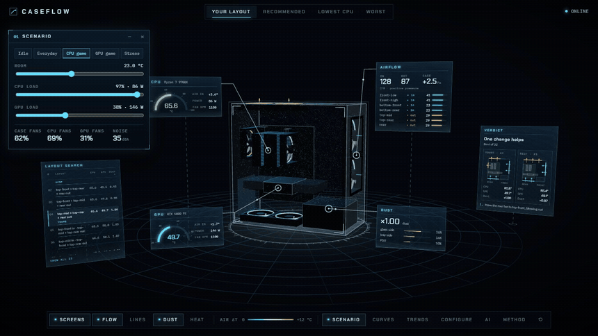

▶ **[完整演示视频（MP4，1440p）](media/caseflow_tour.mp4)**。上面的动图是前 13 秒：拖风扇曲线（机箱风扇加速，CPU 变凉）→ 切到满载 → 把室温拉到 35 °C → 温度切片。

> 建议在 VS Code 里按 `Ctrl+Shift+V` 打开预览看这份文档，图和公式都能正常显示。

---

## 目录

0. [一分钟版本](#0-一分钟版本)
1. [怎么打开](#1-怎么打开)
2. [界面导览](#2-界面导览)
3. [整体架构](#3-整体架构)
4. [一次模拟是怎么算出来的](#4-一次模拟是怎么算出来的)
5. [场景：室温、负载和风扇曲线](#5-场景室温负载和风扇曲线)
6. [32 种布局的搜索](#6-32-种布局的搜索)
7. [结论：你的电脑该怎么装](#7-结论你的电脑该怎么装)
8. [可信度：哪些是算的，哪些是估的](#8-可信度哪些是算的哪些是估的)
9. [代码地图](#9-代码地图)
10. [常用操作](#10-常用操作)

---

## 0. 一分钟版本

| | |
|---|---|
| **输入** | 你的配件：联力 LANCOOL 207 机箱、RTX 5080 公版显卡、利民 PA120 SE 双塔散热器、锐龙 7 9700X；4 个原装风扇 + 你自己的 3 个 120 mm 风扇，以及每个风扇装在哪、往哪吹。<br>**场景是设定值，不从电脑里读**：室温（默认 23 °C）、CPU 和显卡负载（默认是你玩的那个吃 CPU 的游戏：CPU 86 W、显卡 146 W）、风扇曲线（默认是你 Fan Xpert 里的设置）。 |
| **计算** | 1. 把机箱切成 6 mm 的小格子。<br>2. 用自己写的 GPU 流体求解器（格子玻尔兹曼方法），在**机箱风扇的 3 个转速**下同时算出机箱里的风。<br>3. 算出每瓦 CPU 热量、每瓦显卡热量会让空气热多少。<br>4. 放 4 万颗灰尘颗粒，看它们落在哪。<br>这四步合起来叫这个装法的 **bank**，约 90 秒，算一次存下来。<br>5. 之后不管室温、负载、风扇曲线怎么改，浏览器都能在几毫秒里求出**风扇转速和温度互相吻合的稳定状态**。 |
| **搜索** | 你那 3 个风扇放到 4 个空位里的任意 3 个，每个可以进风或出风，一共 **32 种**，每种一个 bank（约 50 分钟全部算完）。排名按你当前设的场景实时重算。 |
| **结论** | **你现在的装法已经很好**：默认场景（吃 CPU 的游戏、23 °C）里排第 4，和第 1 名只差 0.9 °C（CPU + 显卡的总分）；前 4 名都是“3 个都往外吹”。<br>**可以小改**：把后部那个风扇挪到顶部最前面的空位、仍然往外吹（3 个都在顶部出风）。6 个场景里有 5 个排第 1，好处 0.3–1.4 °C；35 °C 满载、风扇都已全速时就打平了。<br>**最差的永远是后部进风**：带后部进风的 12 种，在所有场景里都是最后 12 名。<br>**负载轻时怎么装都差不多**：日常使用时 32 种只差 1.3 °C。 |
| **界面** | 3D 机箱放在中间，周围浮着六块全息屏，每块用发光引线连到对应的部件上；Scenario、Fan curves、Trends 三个玻璃窗口用来改场景、改曲线、看趋势。 |

---

## 1. 怎么打开

| 方式 | 做法 |
|---|---|
| 一键启动 | 双击 `caseflow/start.bat`。它会开两个服务，然后自动打开浏览器。 |
| 网页 | <http://localhost:5190>（Vite + React + three.js） |
| 计算引擎 | <http://127.0.0.1:8600>（FastAPI + PyTorch，用显卡算） |

**引擎没开也能用**：你的布局的 bank 和 32 种布局的 bank 摘要都预先放在 `web/public/data/` 里了。所以室温、负载、风扇曲线的滑块，排名和趋势图，在没开引擎时都能用；3D 里能看到你的布局的气流和温度。

**引擎开着的时候多出来的功能**：
- 其他 31 种布局也能在 3D 里看（bank 都缓存好了，点一下立刻打开）；
- 改了配件或风扇（不在 32 种里的装法），会现场算一个新的 bank（约 90 秒）。

CaseFlow 只做模拟，不读这台电脑的硬件数据。

---

## 2. 界面导览

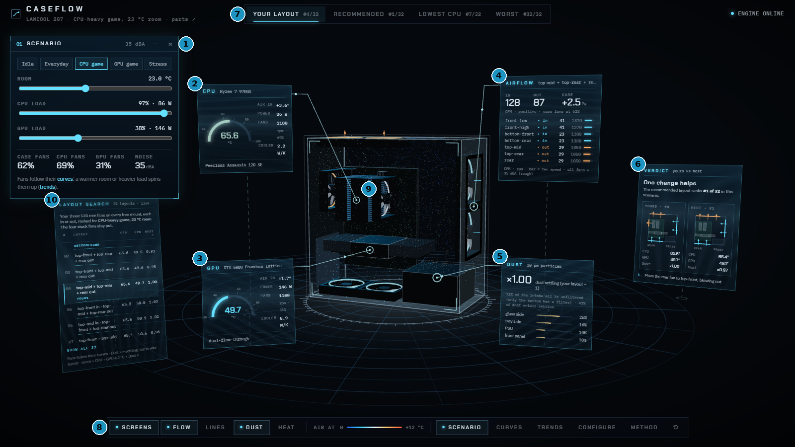

机箱周围浮着六块**全息屏**，每块用一根发光引线连到它描述的那个部件上。屏幕会跟着你的视角转，所以从哪个角度看都正对着你；引线和部件上的锚点固定在机箱里。

| # | 屏幕 / 位置 | 内容 |
|---|---|---|
| ① | **SCENARIO 窗口**（左上） | 负载预设：Idle、Everyday use、CPU-heavy game、GPU-heavy game、Full stress。<br>室温、CPU 负载、显卡负载三个滑块（负载同时显示成瓦数），CPU 型号。<br>下面一排是结果：机箱风扇、CPU 风扇、显卡风扇各转多少，以及估算的噪音（dBA）。 |
| ② | **CPU**（引线 → CPU 散热器） | 半圆仪表显示 CPU 温度，旁边是吸入空气的温升、功率（撞到温度上限时显示“降频”和原本的瓦数）、风扇转速和占空比、散热器导热能力。 |
| ③ | **GPU**（引线 → 显卡） | 同上。显卡风扇停转时显示 *stopped*。 |
| ④ | **AIRFLOW**（引线 → 前面板进风扇） | 总进风 / 出风量（CFM）、机箱内压力、机箱风扇的占空比。<br>下面逐个列出风扇：方向、风量、转速，条的长度是风扇转速。最下面是所有风扇的估算噪音。 |
| ⑤ | **DUST**（引线 → 玻璃侧板前下角） | 外面的灰进来并落下的速度（以你的布局为 1），以及灰落在哪些面上。 |
| ⑥ | **VERDICT**（右侧斜屏） | 在当前场景下，你的布局和最好（或最差）布局的对比，加上侧视示意图。 |
| ⑦ | **视图切换** | Your layout · Recommended · Lowest CPU · Worst，排名都是按当前场景算的。 |
| ⑧ | **底部 dock** | 图层开关：全息屏 Screens、气流粒子 Flow、流线 Lines、积灰 Dust、温度切片 Heat。中间是温度色标。右边是窗口：Scenario、Curves、Trends、Configure、Method，以及 ⟲（视角和窗口复位）。 |
| ⑨ | **引线和锚点** | 部件上的锚点会脉动，引线上有光点从部件流向屏幕。 |
| ⑩ | **LAYOUT SEARCH**（左侧斜屏） | 32 种布局按当前场景的排名：CPU / 显卡温度、积灰速度。点任意一行就切到那种布局。改室温、负载或曲线时，排名会跟着重排。 |

**另外三个窗口**（从 dock 打开）：

| 窗口 | 内容 |
|---|---|
| **Fan curves** | 像 Fan Xpert 一样的曲线编辑器，三条曲线：机箱风扇（可以选跟 CPU 温度、显卡温度或两者中较高的走）、CPU 散热器风扇、显卡风扇。拖动曲线上的点就能改，黄色圆环表示风扇现在跑在曲线的哪一点。改曲线是即时的，不用重新模拟。 |
| **Trends** | 两张折线图：温度随**室温**变化、温度随**显卡负载或 CPU 负载**变化。实线是风扇跟着曲线走，虚线是风扇停在现在的转速不动。鼠标移上去能看每个点的数值，也可以切成表格。 |
| **Configure** | 改配件（机箱、显卡、散热器），以及每个风扇位：进 / 关 / 出、风扇型号、跟曲线走（curve）还是固定占空比（fixed）。 |

**怎么看 3D 场景**：
- **操作**：鼠标左键拖动旋转，滚轮缩放，右键平移。
- **视角**：默认从玻璃侧板偏前面板的角度看，前面板在右边，和你桌上的电脑一样。
- **风扇**：灯圈青色 = 进风，琥珀色 = 出风；扇叶按算出来的转速转，显卡风扇停转时就不转。
- **气流粒子**：沿着算出来的风走，颜色表示那里的空气比室温高多少（蓝 → 青 → 白 → 琥珀 → 红，0 到 +12 °C）。改负载、改室温时颜色立刻变。
- **积灰点**：土黄色的点，表示灰最后停下来的位置。
- **温度切片**：从显卡中间切一刀，越热的地方越不透明，看起来像热浪。
- **差值**：看别的布局时，屏幕上会显示和你的布局的差值。青色 = 更好，琥珀色 = 更差。

| 满载 + 35 °C 室温 + 温度切片 + 风扇曲线 | 点风扇弹出的菜单 |
|---|---|
| 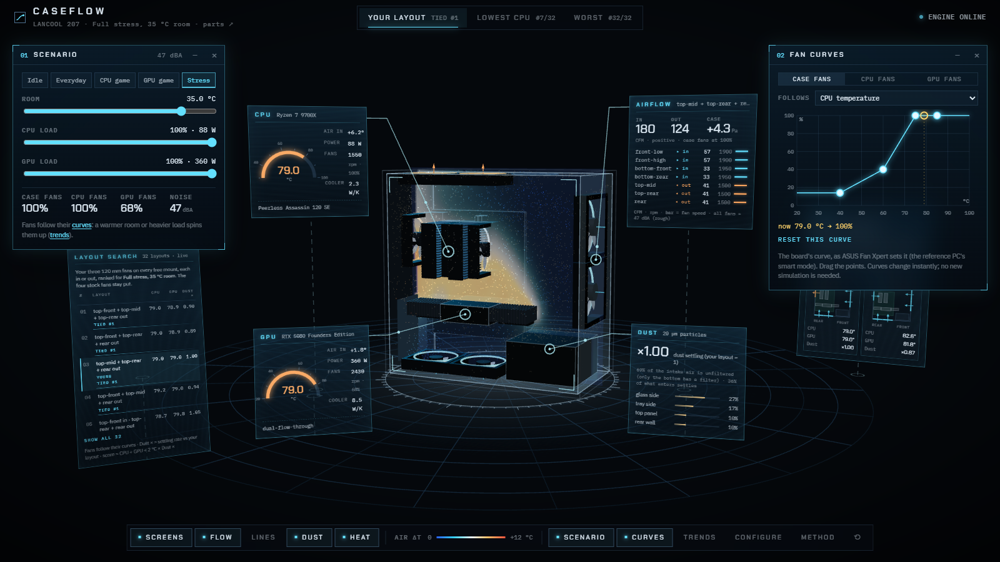 | 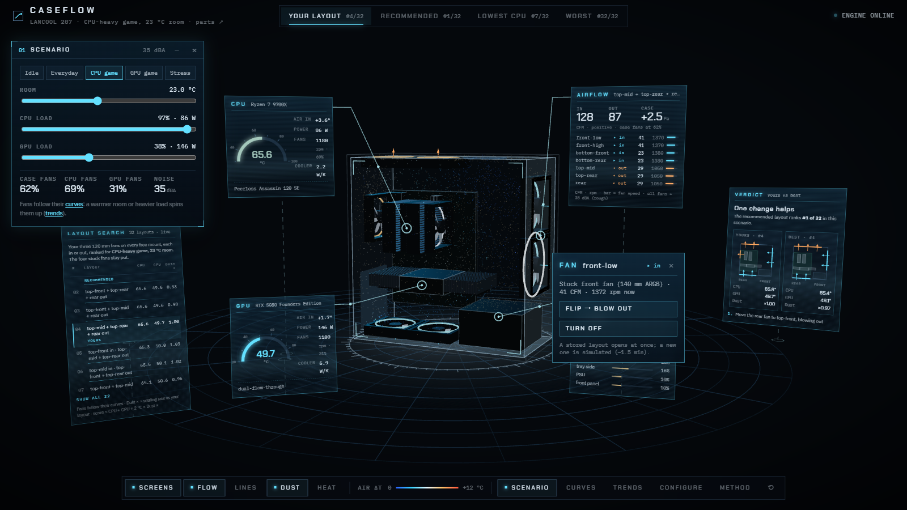 |

**点风扇**：点任意一个机箱风扇，弹出菜单，可以**翻转方向**或**关闭**；点空着的风扇位可以**加一个风扇**。改完后，如果新装法在 32 种里，直接切过去；不在的话，引擎开着就现场算一个新的 bank（约 90 秒），结果出现在 *Custom* 视图。

---

## 3. 整体架构

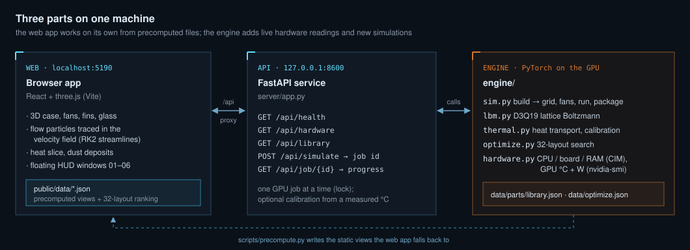

- **引擎**只做一件重活：给每种装法算一个 bank。它把机箱风扇的 3 个转速放在一个批次里一起算，再把“每瓦热量造成的温升”算出来，存进 `data/banks/`。
- **服务**把每次算 bank 当成一个后台任务：网页提交后拿到一个任务 id，再轮询进度。已经算过的装法直接从缓存返回；显卡一次只跑一个任务（加了锁）。
- **网页**负责其余的一切：风扇曲线和温度的稳态、32 种布局的排名、3D 温度场的合成，都在浏览器里算。这部分和引擎里的 Python 版本逐行对应，测试会检查两者算出的结果一致（误差 < 10⁻⁶）。
- 引擎和网页之间只通过 JSON 交流，所以整个文件夹可以单独拿走。

---

## 4. 一次模拟是怎么算出来的

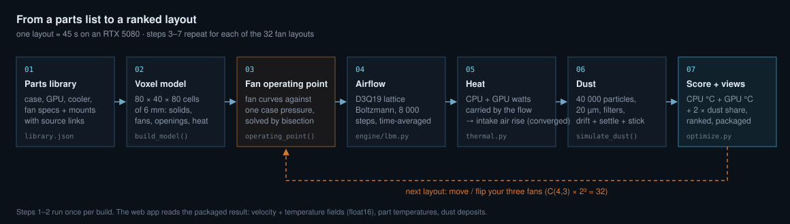

### 4.1 把机箱变成格子（第 1–2 步）

**配件库** `data/parts/library.json` 里每个配件都记了：
- 尺寸、风扇位坐标、风扇参数（额定风量 CFM、静压 mmH₂O、最高转速、0% 占空比时的转速）；
- CPU 的功耗上限和温度上限、散热器和显卡的散热参数、默认风扇曲线、负载预设；
- 来源链接；估计出来的值会标上 `est`。

`build_model()` 把这些放进一个 **80 × 40 × 80** 的格子里（每格 6 mm，最外两层是“房间”和“机箱壁”），每个格子标成一种类型：

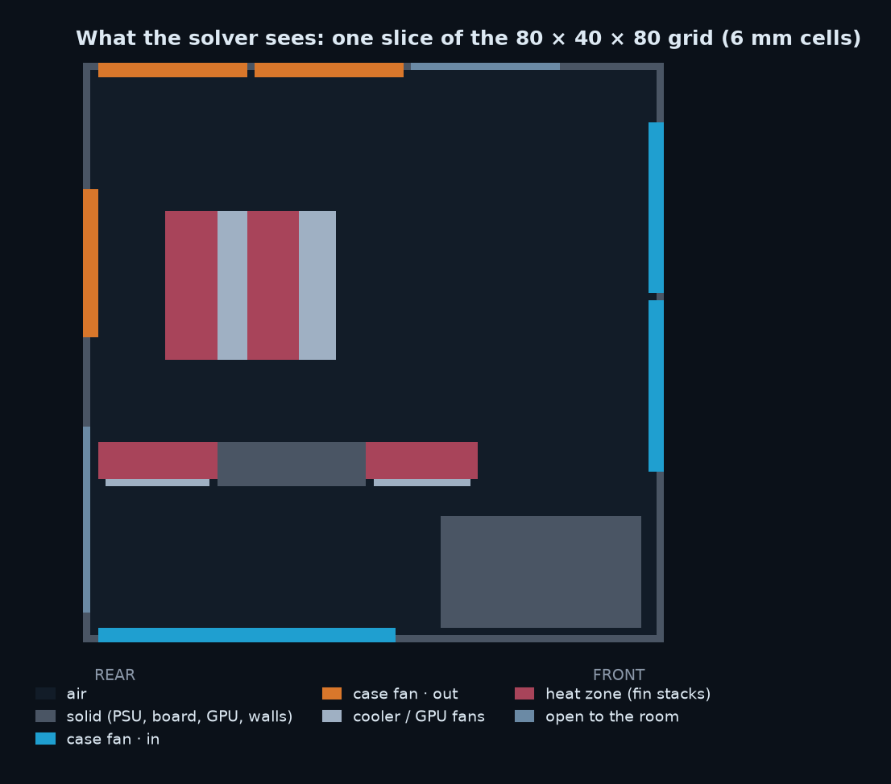

| 类型 | 怎么处理 |
|---|---|
| 实体 | 机箱壁、电源、主板、显卡的 PCB。风碰到会反弹（halfway bounce-back）。 |
| 机箱风扇 | 强制风速的格子，方向朝里（进风）或朝外（出风）。风速由 [4.3 节](#43-风扇工作点第-3-步) 的工作点决定。 |
| 散热器 / 显卡风扇 | 同样是强制风速。CPU 双塔的两个风扇从前往后吹；公版显卡的两个风扇从下往上吹（双通道穿透式散热）。 |
| 发热区 | CPU 的两个鳍片塔、显卡两端的鳍片。热量在这里放进空气。 |
| 通到房间 | 空着的网孔风扇位、PCIe 挡板的通风孔。空气可以自由进出。 |
| 房间 | 最外一圈格子：室内气压、室温，速度跟着紧挨着的内侧格子走（开放边界，见 4.2）。 |

### 4.2 气流：格子玻尔兹曼方法（第 4 步）

不直接解 Navier–Stokes 方程，而是用**格子玻尔兹曼方法（LBM）**。每个格子里存 19 个“粒子分布”$f_i$，表示朝 19 个方向走的空气有多少：

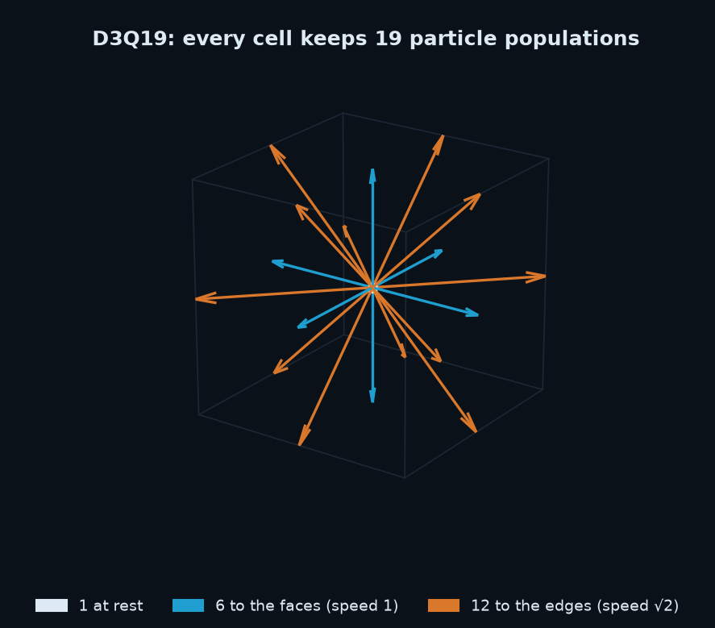

每一步做两件事：

1. **碰撞**：每个格子里的分布向局部平衡态靠拢。用的是 BGK 碰撞，加 Smagorinsky 湍流模型来稳定小尺度的涡。

$$
f_i^{*}(\mathbf x,t)=f_i-\frac{1}{\tau}\left(f_i-f_i^{\text{eq}}\right),\qquad
f_i^{\text{eq}}=w_i\,\rho\left(1+3\,\mathbf c_i\!\cdot\!\mathbf u+\tfrac92(\mathbf c_i\!\cdot\!\mathbf u)^2-\tfrac32 u^2\right)
$$

2. **迁移**：每个分布沿着自己的方向走一格，$f_i(\mathbf x+\mathbf c_i,t+1)=f_i^{*}(\mathbf x,t)$。

密度和速度直接从分布里加出来：$\rho=\sum_i f_i$，$\rho\mathbf u=\sum_i f_i\mathbf c_i$。

**为什么用 LBM**：每个格子只和邻居打交道，几十万个格子可以在显卡上同时算，PyTorch 一行张量操作就能做完一整步。

**具体设置**：
- 机箱风扇的 **3 个转速（占空比 12%、45%、100%）放在一个批次里一起算**：格子完全一样，只有风扇的风速不同，所以一次跑完三种，比分开跑快得多；
- 跑 8000 步（相当于真实时间约 1.6 秒，空气大约在机箱里走三到四遍），取后 4000 步的**时间平均**；
- **机箱外面一圈“房间空气”**是开放边界：压力固定在室内气压，速度取紧挨着的那个格子的速度。这样风扇能把设定的风量真正送进来（实测约 95%）；
- 检查过：再加到 16000 步，温度变化不到 0.1 °C（`scripts/check_convergence.py`）。

### 4.3 风扇工作点（第 3 步）

这一步是在一次“结果不对劲”之后加的。

- **以前**：每个风扇按固定风量算。
- **出问题**：“顶部 3 个全进风、一个出风扇都没有”排到了第一。这不合理：7 个风扇一起往里吹，机箱里的气压会升高，风扇会被顶住，实际风量会大幅下降。
- **现在**：把整个机箱当成一个腔体，所有机箱风扇面对**同一个机箱压力 $p$**。

| | 公式 | 说明 |
|---|---|---|
| 风扇转速 | $s = s_\text{min} + (1-s_\text{min})\times\text{占空比}$ | 大部分 PWM 风扇在 0% 时还会转（$s_\text{min}\approx 0.2\text{–}0.26$）。占空比来自风扇曲线（第 5 节）。 |
| 风扇曲线 | $Q = Q_0\,s\left(1-\dfrac{\Delta p}{p_{\max}s^2}\right)$ | $Q_0$ 是额定风量，$p_{\max}$ 是厂家标的静压，按风扇定律缩放：$Q\propto s$，$p\propto s^2$。 |
| 风扇两边的压差 | 进风扇 $\Delta p=+p$<br>出风扇 $\Delta p=-p$ | 机箱是正压时，出风扇反而被推了一把，流量最多到 1.25 倍。 |
| 被动开口 | $Q = C_d\,A_\text{eff}\sqrt{2\lvert p\rvert/\rho}$ | 按孔板算，$C_d=0.6$。 |
| 质量守恒 | $\sum Q_\text{进}-\sum Q_\text{出}-Q_\text{开口}=0$ | 左边随 $p$ 单调下降，用二分法就能找到唯一解。 |

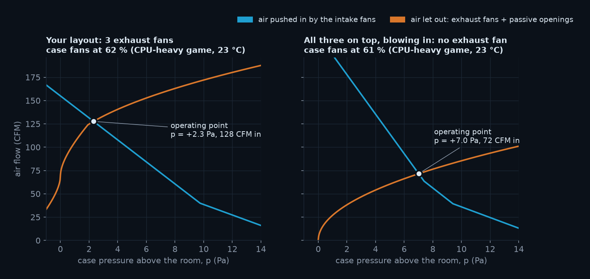

两条线的交点就是工作点（吃 CPU 的游戏、23 °C，机箱风扇按曲线转到 62% 左右）：
- **左图（你的布局）**：机箱比房间高 +2.3 Pa，进风 128 CFM。正压把你的 3 个出风扇推了一把，每个都多送了 25%。
- **右图（顶部全进风）**：压力憋到 +7.0 Pa，总进风只剩 72 CFM。底部两个风扇只剩自由风量的 25%，顶部 3 个几乎被顶死（5%）。

### 4.4 温度：每瓦热量造成的温升（第 5 步）

在 LBM 算出的平均风场上，解一个稳态的**对流–扩散方程**（迎风格式，通量守恒，一直迭代到收敛）：
- 每个发热区每格放进 $P/N$ 的热量；
- 墙不导热；
- 房间格子保持室温。

这个方程对热量是**线性**的：功率翻倍，温升也翻倍；CPU 和显卡的热量各自造成的温升可以直接相加。所以 bank 里存的不是某一个功率下的温度，而是**每瓦 CPU 热量**和**每瓦显卡热量**各自造成的温升场 $k_\text{CPU}$、$k_\text{GPU}$（单位 K/W）。任何负载下：

$$
\Delta T(\mathbf x)=P_\text{CPU}\,k_\text{CPU}(\mathbf x)+P_\text{GPU}\,k_\text{GPU}(\mathbf x)
$$

取 CPU 和显卡**进风口**处的平均值，算零件温度：

$$
T_\text{零件}=T_\text{室温}+\Delta T_\text{进风}+\frac{P}{G(s)}
$$

$G$ 是散热器的导热能力（W/K），随它自己风扇的转速 $s$ 变（第 5 节）。

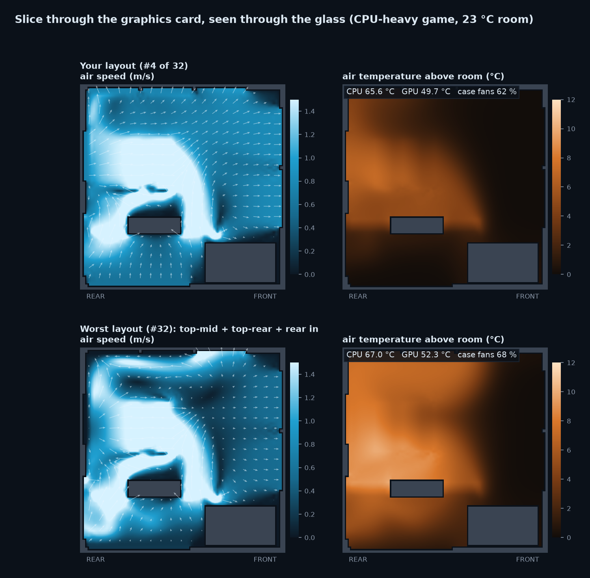

**怎么读这张图**（吃 CPU 的游戏、23 °C；左边是风速和风向箭头，右边是空气温度）：
- **公版显卡**的热风从卡的两端往上冲，正好吹向 CPU 散热器的进风面。所以 CPU 吸进去的空气比室温高 +3.6 °C，其中大部分来自显卡（见 5.3）。
- **底部两个原装风扇**把冷空气直接送到显卡下面，所以显卡吸入的空气只高 +1.7 °C。
- **最差布局（下排：7 个风扇全往里吹）**一个出风扇都没有，机箱憋到 +8.8 Pa，进风只剩 77 CFM（你的布局 128 CFM）。热空气只能从空风扇位和挡板缝里慢慢挤出去：CPU 吸入的空气 +5.3 °C，显卡 +4.5 °C。CPU 更热，机箱风扇也被曲线带到了 68%（你的布局 62%），但还是追不回来。
- **后部进风**是另一种坏法：后部风扇正对着 CPU 散热器的出风口往里吹，把热风顶回去，CPU 吸入的空气同样升到 +5.3 °C。

> **一个被问出来的 bug（温度没算收敛）**
>
> 你问：“全部往里吹，温度怎么还比最差的低？” 查下来，原来温度是固定迭代 5000 次（约 1 秒真实时间），还没收敛，热量没积累够。风量越小，空气在机箱里停留越久，低估得越多。现在的做法：每 2500 次检查一次进风口温度，变化小于 0.005 °C 才停（一般 1.5–4 万次）。

> **第二个问题（全面检查时查出来的）：风扇少送了三成风，热量也不守恒**
>
> 守恒检查（`scripts/sanity_check.py`）发现：机箱外那一圈“房间空气”格子每一步都被强制设成静止，风扇格子和它交界时有一半粒子不带动量，风扇实际只送出约 70% 的风；温度的写法也会凭空加减热量。改成开放边界和**通量守恒**的写法后，风扇送风约 95%，带走的热量 = 输入的 99.9%。修完后 32 种全部重算，全进风真正垫底。

### 4.5 灰尘（第 6 步）

**怎么放灰**：4 万颗 20 µm 的颗粒，从空气**进来**的地方放进去，按各处进风量分配：
- 底部有防尘网，挡住 85%；
- 前面和顶部的网孔不挡灰。

**每一步颗粒怎么动**：跟着平均风走，加上湍流造成的随机扩散（2×10⁻³ m²/s）和重力沉降（斯托克斯速度），碰到表面就粘住。机箱风扇的 3 个转速各算一次。

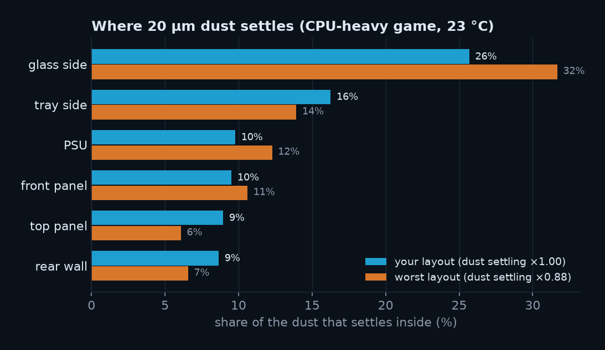

- **最多的是玻璃侧板和背板**，因为机箱窄，颗粒很容易横着飘到两侧。
- **积灰速度** = 没经过防尘网的进风量 × 进来后落下的比例，以你的布局为 1。风扇转得越快，进来的灰越多。6 个场景里，32 种布局只在 ×0.75 到 ×1.06 之间：只有底部有防尘网（官方配置），大部分进风来自不带网的前面板，所以怎么摆风扇对积灰影响很小。
- **想明显少积灰**：前面板加官方的选配防尘网（LAN207-1X），没过滤的进风比例能从约 70% 降到 17%。

### 4.6 打分

$$
\text{score}=T_\text{CPU}+T_\text{GPU}+2\,^{\circ}\mathrm{C}\times(\text{积灰速度，你的布局}=1)
$$

分数越低越好。权重是人为定的：积灰速度翻倍，相当于温度高 2 °C。**打平规则**：和第 1 名的总分差不到 0.5 °C 的布局算并列第一（模型误差内），这时不会建议你改。

---

## 5. 场景：室温、负载和风扇曲线

> **一句话**：真机的风扇会跟着温度转，所以室温高了、负载重了，风扇会加速，抵消掉一部分。模型现在也这样算。

### 5.1 每个设置怎么定

| 设置 | 默认值 | 说明 |
|---|---|---|
| **室温** | 23 °C | 你房间的温度。滑块 10–40 °C。 |
| **负载** | 吃 CPU 的游戏：CPU 86 W，显卡 146 W | 负载从待机（0%）到功耗上限（100%）：9700X 是 22–88 W，RTX 5080 是 15–360 W。预设：Idle、Everyday use（42 W / 15 W）、CPU-heavy game（86 W / 146 W）、GPU-heavy game（68 W / 326 W）、Full stress（88 W / 360 W）。其中“日常使用”和“吃 CPU 的游戏”就是你电脑上实测过的功率。 |
| **机箱风扇曲线** | 40 °C → 14%，60 °C → 40%，75 °C → 100%，跟 CPU 温度 | 你 Fan Xpert 里的智能模式。可以改成跟显卡温度，或两者中较高的那个；也可以让某个风扇固定占空比。 |
| **CPU 风扇曲线** | 40 °C → 15%，60 °C → 50%，75 °C → 100% | 同上，Fan Xpert。 |
| **显卡风扇曲线** | 40 °C 以下停转，45 °C 30%，70 °C 45%，88 °C 100% | 按公版 5080 拟合：你的电脑实测 49 °C 时 31%，待机时停转。 |
| **散热器** | $G=1/(r_\text{base}+r_\text{air}\,s^{-0.7})$ | 风扇转得越快，鳍片散热越好（换热系数约正比于风速的 0.7 次方）。$r_\text{base}$ 是芯片自己的那段热阻（核心、钎焊、顶盖、硅脂）。两个参数各用你电脑上的一组实测数据拟合（5.6）。 |
| **使用率** | 不用 | 发热只看功率。负载滑块旁边会显示对应的瓦数。 |

### 5.2 风扇曲线和稳态：怎么求“风扇和温度互相吻合”的状态

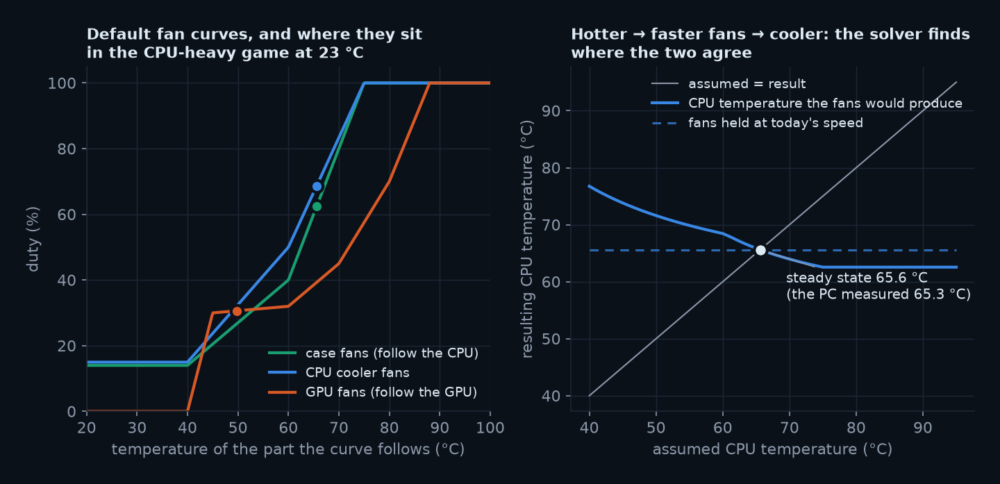

左图是三条默认曲线，圆点是吃 CPU 的游戏、23 °C 时风扇实际跑的位置。右图解释怎么求解：
- **横轴**是假设的 CPU 温度。假设 CPU 是这个温度，风扇就按曲线转到对应的转速，于是机箱风量、散热器的导热能力都定了，可以算出 CPU **实际**会是多少度（蓝线）。
- 假设得越热，风扇转得越快，算出来的反而越凉，所以蓝线往下走；它和对角线（假设 = 结果）只有一个交点，那就是稳态：**65.6 °C**（你的电脑实测 65.3 °C）。
- 虚线是“风扇停在现在的转速不动”：结果和假设无关，是一条水平线。
- 程序里 CPU 和显卡的温度各用二分法求，交替几次直到都不变，每个场景约 1–2 毫秒。
- **降频**：如果算出来超过温度上限（9700X 是 95 °C，5080 按 88 °C），就把那个部件的功率往下调，直到正好停在上限。屏幕上会显示“throttled”和原本的瓦数。
- **噪音**：每个风扇按“转速每低一个数量级，噪音低 50 dB”估算后加起来。只适合比较不同设置，不是分贝仪读数。

### 5.3 为什么能实时：bank

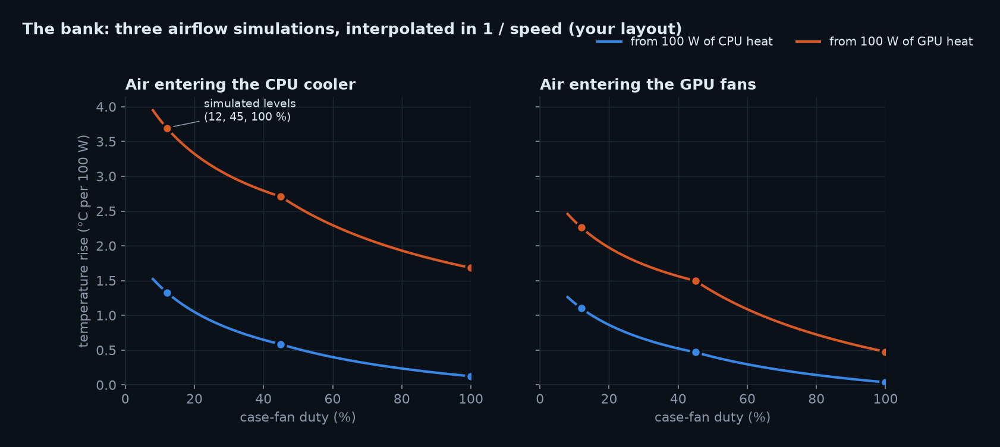

- 每种装法只在机箱风扇的 **3 个占空比（12%、45%、100%）** 下真正跑 LBM（图里的圆点）。
- 中间的转速，按 **1 / 转速** 线性插值（温升大约和风量成反比，插值曲线就是图里的线）。
- 两个看得出来的事实：
  - **显卡的热量是 CPU 进风变热的主要原因**：每 100 W 显卡热量让 CPU 吸进的空气热 1.7–3.7 °C，比 CPU 自己的 0.1–1.3 °C 大得多。公版显卡的热风正好往上吹进 CPU 散热器。
  - **机箱风扇从 12% 开到 100%**，显卡热量对 CPU 进风的影响减少一半多。
- 这样做有两个近似：插值；以及散热器和显卡自己的风扇在机箱里搅动空气时，用一个代表性的转速。第 8 节用完整模拟检查过，误差不超过 0.51 °C。

### 5.4 室温的影响

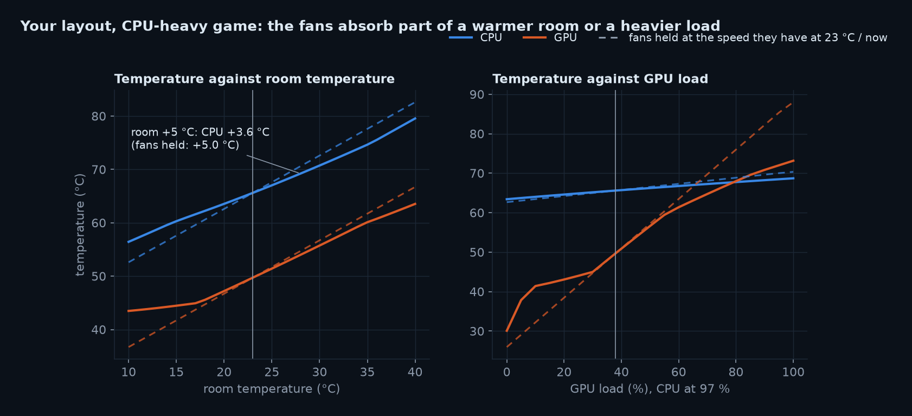

**左图回答了“室温改几度，机箱里是不是就改几度”**：
- **风扇不随温度变的话（虚线），是的**：空气的温升只由风量和功率决定，和室温无关，所以室温高 5 °C，所有温度刚好高 5 °C。
- **风扇跟着曲线走（实线），升得少**：室温从 23 °C 到 28 °C，CPU 只热 3.6 °C。反过来，房间冷的时候风扇会减速，温度降得也比室温少。
- 显卡在 45–60 °C 之间的曲线几乎是平的（30–32%），所以那一段显卡的温度跟着室温走得比较多。
- 到了曲线的顶端（风扇已经 100%），风扇没法再加速，实线又会和虚线平行。

### 5.5 负载的影响

右图是显卡负载从 0 到 100%（CPU 保持 97%）：
- **显卡风扇在低负载时停转**：负载很小时温度先上到 40–45 °C，风扇才开始转，所以曲线在左下角有一个台阶。
- **负载越重，风扇加速越多**：到 100% 时，实线比虚线低 15 °C 左右。
- **CPU 温度几乎不受显卡负载影响**：机箱风扇跟的是 CPU 温度，显卡变热时它们不会加速；显卡多出来的热风大部分被显卡风扇和顶部出风带走。想让机箱风扇照顾显卡，可以在 Fan curves 里把机箱风扇改成跟“两者中较高的”温度走。

**换一颗 CPU**（Scenario 窗口里选；不影响气流，所以不用重新模拟）。全部满载，同一个散热器：

| CPU（功耗上限） | 室温 23 °C | 室温 35 °C |
|---|---|---|
| 锐龙 7 9700X（88 W） | 69.3 °C | 79.0 °C |
| 锐龙 9 9950X（230 W） | 93.7 °C | 95 °C，**降频**到 192 W |
| 酷睿 i7-14700K（253 W） | 100 °C，刚好卡在上限 | 100 °C，**降频**到 210 W |

双塔风冷压 14700K 满载会撞温度墙，这和实际情况一致。

### 5.6 和你的电脑对比

为了检查模型，2026-11-08 在你的电脑上记录过两段 30 分钟的数据（Corsair iCUE 的传感器记录，加上 Windows 的功率计数器）。之后就不再读取了：

| 场景（室温 23 °C） | 实测 | 模型 |
|---|---|---|
| 吃 CPU 的游戏：CPU 86 W，显卡平均 145 W | CPU 65.3 °C，显卡 49.3 °C，显卡风扇 31% | CPU 65.6 °C，显卡 49.7 °C，显卡风扇 31% |
| 日常使用：CPU 42 W，显卡 14 W | CPU 52 °C，显卡风扇停转 | CPU 45.7 °C，显卡风扇停转 |

- 游戏那一行是拟合点：散热器和显卡的散热参数就是用它定的，所以对得上是应该的。
- 日常使用那一行是独立检验：显卡风扇停转对得上；CPU 模型低了约 6 °C。轻负载时锐龙的温度主要由一下一下的单核加速峰值决定，只看平均功率的模型看不到这些峰值。

---

## 6. 32 种布局的搜索

**怎么搜**：
- 原装 4 个风扇（前 2 × 140 进风、底 2 × 120 进风）保持原样；所有机箱风扇都跟着机箱风扇曲线转；
- 你的 3 个 120 mm 风扇放到 4 个空位（顶前 / 顶中 / 顶后 / 后部）里的任意 3 个，每个可以进或出：$\binom43\times2^3=32$ 种；
- 每种都算一个 bank（`engine/optimize.py`，约 50 分钟，断了可以接着算）。
- 有了 32 个 bank，**任何场景下的排名都只要几十毫秒**：网页里改室温、负载、曲线时，排名实时重排。

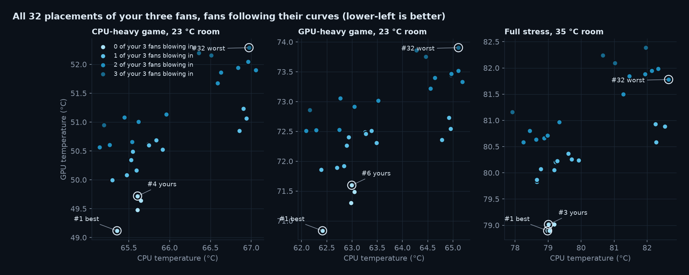

点越亮，表示你的 3 个风扇里往里吹的越少。三张图是三个场景：

| 规律 | 证据 |
|---|---|
| **全部出风最好** | 有负载的 5 个场景里，有 4 个的前 4 名正好是 4 种“0 个进风”的布局；吃显卡的游戏（23 °C）时它们在前 6 名。其中最好的是 3 个都在顶部往外吹（后部空着）：顶部 3 个出风扇正好盖住整张显卡的长度，显卡往上排的热风直接被抽走。 |
| **每多一个进风，显卡就更热** | 吃显卡的游戏、23 °C，显卡温度：0 个进风 70.8–71.6 °C，1 个 71.9–72.7 °C，2 个 72.5–73.5 °C，3 个 72.9–73.9 °C。顶部往里吹会“压住”显卡往上排的热风。 |
| **后部进风最差** | 6 个场景里，带“后部进风”的 12 种永远是第 21–32 名。满载（23 °C）时它们的 CPU 70.6–71.9 °C，比全部出风的高 1–3 °C。 |
| **负载重、风扇还没到全速时，装法最重要** | 你的布局和第 1 名的差距：吃显卡的游戏 1.4 °C（机箱风扇约 50%）、满载 0.8 °C（约 77%）、35 °C 满载 0.3 °C（100%，前 4 名打平）。风扇越有余量，好装法省下的那一点就越能变成更低的转速和温度。 |
| **负载轻时差别很小** | 日常使用（机箱风扇约 21%），32 种只差 1.3 °C，排名主要由积灰决定。 |
| **积灰差别很小** | 积灰速度在 ×0.75 到 ×1.06 之间，排名基本由温度决定。 |

**CPU 最低的那种**会随场景变（吃 CPU 的游戏时是“顶前 + 顶中进风、顶后出风”，满载时是“顶部 3 个都往里吹”）：冷风从顶上直接落到 CPU 散热器上，CPU 比你的布局低 0.5–1.1 °C，但显卡热 0.9–2.2 °C，不划算。

---

## 7. 结论：你的电脑该怎么装

> **你现在的装法已经很好**：默认场景（你玩的那个吃 CPU 的游戏、23 °C）里排第 4（CPU 65.6 °C、显卡 49.7 °C），和第 1 名只差 0.9 °C。
>
> **想再好一点，只要动一个风扇**：把后部那个风扇拆下来，装到顶部最前面那个空位，仍然往外吹。这样 3 个风扇都在顶部往外吹，后部空着；机箱是正压，后部那个空位自己也会往外排气。
>
> 结果：6 个场景里有 5 个排第 1（日常使用时排第 3，那时 32 种只差 1.3 °C）。比你现在的布局好 0.3–1.4 °C：吃显卡的游戏好处最大（显卡低 0.8 °C、CPU 低 0.6 °C），35 °C 满载时风扇都已经全速，两者打平。好处不大，不改也完全可以。

如果以后要动风扇：
- **顶部用哪两个孔无所谓**，方向才重要：保持往外吹。
- **别把顶部的风扇改成进风**：进风越多显卡越热（0.3–3.5 °C），CPU 几乎没好处。
- **千万别把后部风扇改成进风**：它会把 CPU 散热器吹出来的热风顶回去，在所有场景里都是最差的 12 种。
- **别全部往里吹**：没有出风扇时热空气排不出去。
- **夏天房间热**：风扇曲线会自己加速，室温高 5 °C，CPU 只热约 3.6 °C（5.4 节）；想更凉可以在 Fan curves 里把机箱风扇曲线中间那个点往上拖，代价是噪音。
- **玩吃显卡的游戏**：机箱风扇默认只看 CPU 温度，显卡热了它们也不加速。可以在 Fan curves 里把机箱风扇改成跟“两者中较高的”温度走。
- **想少进灰**：主要靠底部有防尘网的进风。前面的网孔不挡灰，可以考虑在前面加一层防尘网。

---

## 8. 可信度：哪些是算的，哪些是估的

| 类别 | 内容 |
|---|---|
| **来自规格或实测** | 机箱尺寸和最大显卡长度、风扇额定风量和静压、显卡长度和功耗上限、CPU 功耗上限和温度上限、散热器高度（官方规格页，链接在配件库里）；你电脑上记录的两组数据（5.6）。 |
| **估计值**（配件库里标了 `est`） | 风扇位的具体坐标、PCIe 挡板通风面积、开孔率、防尘网效率（85%）、风扇装机后的折减（0.6）、风扇 0% 时的转速、散热器和显卡的散热参数（用一组实测拟合）、CPU 待机功耗。 |
| **模型简化** | 6 mm 的格子；为了数值稳定，求解器的黏度比真实空气大。风扇是均匀的出风面，没有旋转气流。跟曲线的机箱风扇共用一条曲线。散热器和显卡自己的风扇在机箱里搅动空气时用一个代表性转速（它们的转速只改变散热器本身的导热能力）。没有算热空气上浮；机箱外的空气永远是设定的室温。 |
| **做过的检查** | ① LBM 求解器在风洞项目里验证过：球体阻力、质量守恒、阻塞比；<br>② **即时求解 vs 完整模拟**（`scripts/validate_bank.py`，见下表）；<br>③ 测试（`tests/`）：风扇不随温度变时室温刚好平移、跟曲线时升得少、解是自洽的、显卡风扇待机停转、降频正好停在上限、浏览器里的求解器和 Python 版本结果一致；<br>④ 收敛（`scripts/check_convergence.py`）：温度迭代到 8 万次、气流算到 1.6 万步，变化 < 0.1 °C；<br>⑤ 守恒（`scripts/sanity_check.py`）：风扇实际送风 ≈ 设定的 95%，带走的热量 = 输入的 99.9%；<br>⑥ 和你的电脑对照（5.6）。 |

**即时求解准不准**：bank 方法有两个近似（插值；散热器和显卡风扇用代表性转速）。`validate_bank.py` 把两个近似都去掉：在求出的转速下，每个风扇都按**准确的转速**重新完整模拟，再按曲线更新转速，直到不再变化，然后和即时求解比较：

| 场景 | CPU：即时 − 完整 | 显卡：即时 − 完整 |
|---|---|---|
| 日常使用，23 °C | +0.19 °C | −0.21 °C |
| 吃 CPU 的游戏，23 °C | +0.19 °C | −0.07 °C |
| 吃显卡的游戏，23 °C | +0.18 °C | +0.02 °C |
| 满载，35 °C | +0.36 °C | −0.51 °C |

每个场景完整模拟一次就收敛了：即时求解给出的转速本身就是自洽的。

**敏感性**（在旧的固定转速模型上做的）：热扩散系数、风扇折减、开孔率、显卡插槽高度、前面板防尘网、更细的 4 mm 网格，每次只改一个，绝对温度会变 2–3 °C，但排名不变，只有本来就几乎打平的布局之间换过位置。这些参数和风扇曲线无关，结论在新模型里同样成立。

所以：**布局之间的比较是可信的**；绝对温度会随这些参数变 2–3 °C。

---

## 9. 代码地图

```
caseflow/
├─ start.bat                一键启动（引擎 :8600 + 网页 :5190）
├─ engine/
│  ├─ lbm.py                D3Q19 LBM 求解器（PyTorch，显卡，支持批量）
│  ├─ sim.py                build_model() 建格子 · operating_point() 风扇工作点 ·
│  │                        run_airflow_batch() 3 个转速一起算 · simulate_dust() 积灰
│  ├─ thermal.py            对流–扩散；solve_unit_fields() 每瓦温升场（批量）
│  ├─ bank.py               一种装法 → bank（3 个转速的摘要 + 8 位 3D 场），缓存在 data/banks
│  ├─ scenario.py           风扇曲线、散热器导热能力、稳态求解、降频、噪音
│  └─ optimize.py           32 种布局，每种一个 bank，按场景排名
├─ server/app.py            FastAPI：/api/health /library /default_build /bank /job/{id}
├─ scripts/
│  ├─ precompute.py         网页离线用的数据 → web/public/data/
│  ├─ scenario_table.py     你的布局在各种负载、室温下的结果表
│  ├─ validate_bank.py      即时求解 vs 完整模拟
│  ├─ check_convergence.py · sanity_check.py · sensitivity.py   收敛、守恒、敏感性
│  └─ serve.sh              引擎（断了自动重启）
├─ data/                    parts/library.json 配件库 · optimize.json 搜索结果 · validation.json · banks/（缓存，不进 git）
├─ tests/                   test_engine.py · test_bank.py · test_scenario.py（不用显卡）
├─ web/src/
│  ├─ App.tsx               场景状态、排名、窗口（Scenario / Fan curves / Trends / Configure / Method）、全息屏
│  ├─ scenario.ts           浏览器里的稳态求解（engine/scenario.py 的逐行移植）
│  ├─ fields.ts             解码 bank 的 3D 场，按场景合成温度场
│  ├─ Scene.tsx             three.js 场景：机箱、风扇、流线、粒子、温度切片、积灰、全息屏
│  ├─ CurveEditor.tsx       风扇曲线编辑器
│  ├─ TrendChart.tsx        趋势图（十字线提示、图例、表格视图）
│  ├─ Holo.tsx              全息屏：外框、温度仪表、各个面板
│  ├─ HudWindow.tsx         可拖动、折叠的玻璃窗口
│  └─ streamlines.ts · models.ts · viewer.ts · palette.ts
└─ docs/                    这份讲解、图（make_figures.py）、截图、视频（make_video.py）
```

---

## 10. 常用操作

```bash
cd caseflow

# 32 种布局各算一个 bank（约 50 分钟，断了可以接着跑），再生成网页离线用的数据
python engine/optimize.py
python scripts/precompute.py

# 你的布局在各种负载、室温下的结果
python scripts/scenario_table.py --rooms 18 23 28 35

# 检查：即时求解 vs 完整模拟（约 4 分钟），以及不用显卡的测试
python scripts/validate_bank.py
python -m pytest tests

# 重新生成文档里的图 / 视频（网页要开着）
python docs/make_figures.py
node web/scripts/tour.mjs <临时目录>  &&  python docs/make_video.py <临时目录>
```

**加一个新配件**（比如换了 CPU 或散热器）：在 `data/parts/library.json` 里照着已有的条目加一项（尺寸、风扇、散热参数、来源链接）。换 CPU 不影响气流，在 Scenario 窗口里选它就立刻生效；换机箱、显卡、散热器会改变气流，在 Configure 里选它，引擎会算一个新的 bank。也可以直接告诉 Claude Code 型号，让它上网查规格后加进去。
